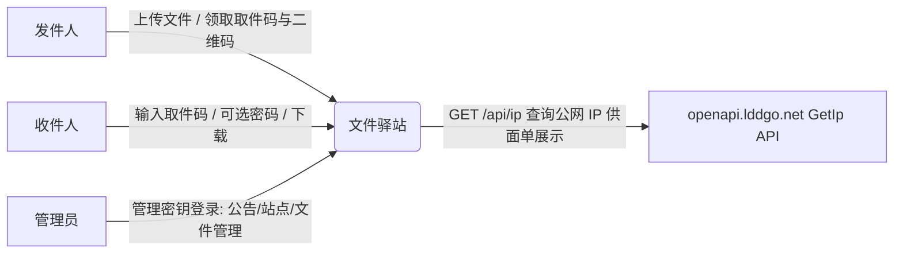

# C1: Context 视图（文件驿站 · 匿名文件共享）

> C4 Level 1 | 对应 RFC-001 | Updated: 2026-10-12 | 状态：首版，系统边界与外部系统现状

## 1. 系统边界

文件驿站是一个**匿名文件中转站**：发件人上传文件获得 6 位取件码，收件人凭码下载，无需注册登录；分享在有效期或下载次数任一耗尽后自动销毁。

## 2. 参与者与职责

| 参与者 | 交互 | 说明 |
|---|---|---|
| 发件人 | 上传页 `/`：选文件 → 填写收件信息 → 取件码/二维码回执 | 可设有效期、次数、备注、自定义码、取件密码 |
| 收件人 | 取件页 `/d/:code`：输码 → 可选密码 → 下载 | 无账号；次数/有效期耗尽即销毁 |
| 管理员 | `/admin*`：仪表盘、文件管理、站点设置 | 头 `x-admin-key` 鉴权；导航不暴露入口 |

## 3. 外部系统

| 系统 | 用途 | 失败降级 |
|---|---|---|
| `openapi.lddgo.net` GetIp | 面单展示寄件方公网 IP | 回退 `req.ip`；3s 超时、60s 缓存 |

## 4. 关键约束

- 运行在单 Node 进程 + 本地文件系统（`data/`），无数据库、无外部队列。
- 服务默认 HTTP；HTTPS 由前置反向代理终止。
- 传输优化目标：磁盘占用（压缩）与吞吐（分片并行）——见 RFC-001。
