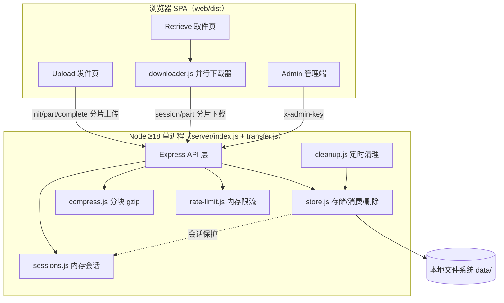

# C2: Container 视图（文件驿站 · 匿名文件共享）

> C4 Level 2 | 对应 RFC-001 | Updated: 2026-10-12 | 状态：首版，反映压缩与分片会话组件加入后的运行单元与协议

## 1. 容器与运行单元

## 2. 进程与协议

| 单元 | 职责 | 协议/技术 |
|---|---|---|
| 浏览器 SPA | 发件/取件/管理 UI；分片上传与并行下载客户端 | HTTPS/HTTP + fetch/XHR；File System Access API 或 Blob 落盘 |
| Node 单进程 | API、静态托管、SPA 回退、定时清理、会话管理 | Express 4 ESM；multer/express.raw；zlib |
| 本地文件系统 | `data/meta/<code>.json`、`data/files/<code>`（可能为 gzip 块容器）、`data/tmp/*` | fs sync/stream |

## 3. 关键数据流

- **上传**：浏览器切片 → `upload/init`（会话+限流）→ 并行 `upload/part` 偏移写 `tmp/<uploadId>.bin` → `upload/complete` → 分块 gzip（可选）→ `store.commitUpload` 落位 `files/<code>` + `meta/<code>.json`。
- **下载**：`download/session`（消费 1 次 + token）→ 并行 `download/part`（按原始范围，压缩容器按块解压切片）→ 浏览器流式写盘/Blob 保存 → `download/end` 或 TTL 回收。
- **销毁**：`getActive`/`cleanup.expired` 检测失效；存在活跃会话时延迟物理删除（会话保护），`/end` 与 TTL 清扫最终回收。

## 4. 部署与运行时

- 单机部署：`npm run build` → `npm start`（:3000）；开发 `npm run dev`（:3000 + :5173 代理）。
- 运行时数据全部在 `data/`（`DATA_DIR` 可配）；测试用 `data-test/`（端口 3999）。
- 无数据库、无消息队列；会话为内存态（重启即失效，见 RFC-001 §5）。
