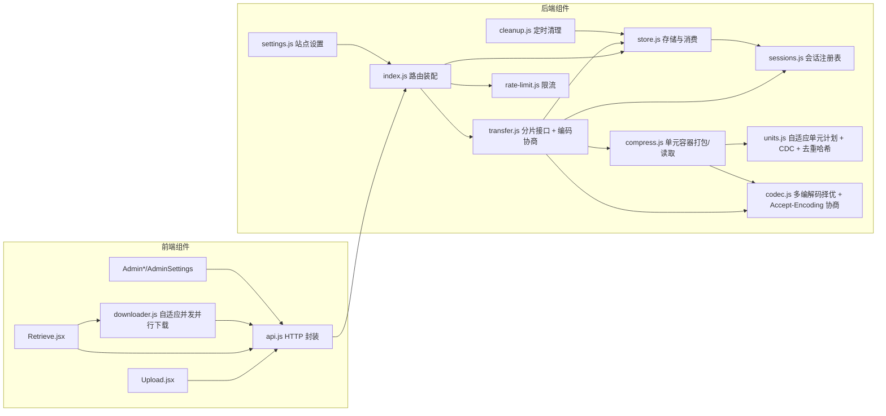

# C3: Component 视图（文件驿站 · 匿名文件共享）

> C4 Level 3 | 对应 RFC-001~007、ADR-001~016（RFC-006 ~ RFC-007 均已实现；RFC-006/ADR-015 默认 off） | Updated: 2026-10-13 | 状态：含压缩/分片传输域与**自适应单元 + 传输压缩**（RFC-002）、**传输节省观测/编码候选开关/导出与清零**（REQ-019/020/023）、**断点续传**（RFC-003，REQ-024~029）、**公告样式（位置/滚动/配色）**（RFC-004，REQ-030~035）、**公告预设**（RFC-005，REQ-036~041）、**多公告 / 定时投放**（RFC-007/ADR-016）、**跨文件去重**（RFC-006/ADR-015，开关 `CROSS_FILE_DEDUP` 默认 off）与**压缩后台化 + OPFS 下载续写**（backlog B1-2/B4-10），组件 ↔ RFC/测试 追溯见 §5

## 1. 总览图

## 2. 组件详述与追溯

### 2.1 传输与存储域（RFC-001 P0）

| 组件 | 文件 | 职责 | 关联 |
|---|---|---|---|
| 分片接口 | `server/transfer.js` | upload/init·part·complete、download/session·part·end；新增 upload/status、download/status 与 `init` 的 `uploadId` 复用；下发自适应分片计划；按 `Accept-Encoding` 选 `store`/`recompress`/`raw`；express.raw 分片体限制；会话清扫定时器；**每 IP 会话/临时空间配额拦截**（新建上传会话按会话数与声明总字节校验，下载会话按会话数校验且发生在 `tryConsume` 之前，超限 429） | RFC-001 §4.2、RFC-002 §4.2、RFC-003 §4.2、ADR-002（会话制与配额）、ADR-006/012 |
| 会话注册表 | `server/sessions.js` | 下载 token（TTL 10min，含归属 IP）内存注册；上传会话（TTL 30min）以 `tmp/<id>.json` 位图 + `<id>.bin` 持久化（位图额外记归属 IP），`markUploadPart` 原子落盘、`restoreUploadSessions` 启动恢复、`dropUploadSession`/sweep 清理；`hasActiveSession` 供 store 防护；`countDownloadSessions`/`uploadTmpUsage` 做按 IP 配额记账（只看未过期会话）；无外部依赖（防循环引用） | RFC-001 §4.3、RFC-003 §4.1、ADR-002/012 |
| 单元容器 | `server/compress.js` | `packContainer`（内嵌容器，不再自行改名）/`packManifest`（清单化容器：单元载荷入对象存储）/`downloadPlan`/`downloadUnits`（按 `compression` 分派内嵌/清单）/`readUnit`/`readRanges`/`streamOriginal`/`streamStoredPayload`/`unitsPayloadOk`/`planPayloadOk`/`unitPayloadFits`；旧 `gzip-blocks` 与 `units-v2` 只读兼容 | RFC-002 §4.1、RFC-006 §4.2、ADR-004/005/015 |
| 压缩任务队列 | `server/jobs.js` | 纯内存任务表（`pending`/`running`/`done`/`failed` + `result`/`error`）+ **并发 1 的串行队列**：`enqueue(label, task, key)`/`getJob`/`getJobByKey`（按 uploadId 或取件码轮询）/`queueStats`（health 的 `compressQueue`）；任务表不落盘（重启即丢，由启动修复收尾） | RFC-001 §4.5、backlog B1-2 |
| 压缩任务 | `server/compress-job.js` | `compressionPlanned`（开关 ∩ 可压缩性，决定是否标 pending）、`enqueueCompression`（把压缩入队）、`compressionJob`（任务快照）；任务流程 = CAS 清单优先 → 内嵌容器回退 → 无收益回退未压缩；内嵌路径先写 `meta/<code>.packmeta` 边车、再改名、最后回写元数据 | backlog B1-2、RFC-006 §4.4、ADR-001 修订一 |
| 对象存储 | `server/objects.js` | 跨文件去重的内容寻址存储：`objectPath`（`objects/<h 前2位>/<h 后62位>`）/`writeObject`（tmp + rename，已存在即命中）/`readObject`/`objectSize`/`streamObject`；`collectManifests`（扫全部清单派生被引用集合）/`objectStats`/`referencedStats`（收益比口径）/`sweepObjects`（标记-清扫，无引用且过宽限期才删）/`dedupState`（health） | RFC-006 §4.1/4.3/4.4、ADR-015 决策 2/3/4 |
| 单元切分 | `server/units.js` | `chunkPlan`/`chunkBounds`/`chunkFile`/`chunkRanges`（Gear-hash 内容定界）/`contentHash`/`unitRanges`/`unitsCoverage`/`unitsCoverageHashed`（清单化覆盖校验）/`uniformRanges` | RFC-002 §4.1、RFC-006 §4.2、ADR-004 |
| 编解码与协商 | `server/codec.js` | `encodeUnit`（raw/gzip/brotli 择优）/`decodePayload`/`parseAcceptEncoding`/`acceptsEncoding`/`planTransferCodec`/`encodeForTransfer` | RFC-002 §4.2、ADR-005/006 |
| 存储 | `server/store.js` | `commitUpload`（含压缩/清单字段与 `compressionState`，支持 `passwordHash` 直传）、`tryConsume`（会话保护）、`getMeta` 导出、`hashPassword`（SHA-256）、`cleanupExpired`（会话保护）、`removeShare` 同时回收传输维度条目（墓碑）、`bodyAvailable`（按容器类型判主体存在：清单化无 `files/<code>`）；压缩态：`updateCompression`/`writePendingCompression`/`clearPendingCompression`（边车）/`repairPendingCompressions`（启动收尾）/`waitForSettledBody`（下载闸门） | RFC-001 §4.1/4.3、RFC-003 §4.1、RFC-006 §4.3、backlog B1-2、ADR-010/012 |
| 站点设置 | `server/settings.js` | `compressionEnabled` 开关；`compressionCodecs`（编码候选，生效值 = 设置 ∩ `COMPRESS_CODECS`）；`presetLimit` + `effectivePresetLimit()`（公告预设上限，`0` 回退默认 10，钳制到 env `MAX_NOTICE_PRESETS`） | RFC-001 §4.5、RFC-002 §4.4、ADR-008/014 |
| 计数与统计 | `server/stats.js` | 累计计数器单例：上传/下载次数 + 传输字节（`recordTransfer`）；维度数据（按日/按文件，`readTransferStats`/`dayKey`/`forgetFileStat`）与保留策略；内存聚合 + 合并读 + 32 片/2s 刷盘 + `flushCounters()`；导出（`transferExportRows`/`toCsv`，RFC 4180）与清零（`resetTransferStats`，`resetAt`/`resetCount` 审计） | RFC-002 §4.4、ADR-007/009/010/011 |
| 路由装配 | `server/index.js` | 启动时 `replayWal`（统计 WAL）→ `repairPendingCompressions`（压缩残局）→ `restoreUploadSessions`；注册 transfer 路由、单请求上传/下载走后台压缩（不入队路径的判定=开关 ∩ 可压缩性）、health features + `compressQueue` + `dedup`、admin stats（磁盘节省 + 传输节省 + **跨文件去重收益**） | RFC-001 §4.5、RFC-002 §4.4、RFC-003 §4.1、RFC-006 §4.4、backlog B1-2/B4-2 |

### 2.2 前端域（RFC-001 P1）

| 组件 | 文件 | 职责 | 关联 |
|---|---|---|---|
| 并行下载器 | `web/src/downloader.js` | 按 `fs-download:<码>` 优先续用 `download/status`（不重复消费；成功才 `end` 并清理）；会话→按服务端 `units` 计划 `index` 取片→自适应并发（内存预算/建议值/成功反馈）→分片长度校验→**落盘三态**：用户句柄 > OPFS 暂存（`fs-download-<码>.part`，每 4 片 `close()` 提交、刷新后按已提交前缀只补缺口、完成后用 blob URL 导出）> 内存 Blob 回退；`navigator.locks` 多标签互斥（拿不到锁回退 Blob）；进度、取消 | RFC-002 §4.3、RFC-003 §4.3、ADR-003 修订一/004/012 修订二 |
| 仪表盘/设置页 | `web/src/pages/Admin.jsx`、`AdminSettings.jsx` | 传输节省卡片（节省字节 + 线上/原始副行、今日行、近 7 日明细）；导出 CSV 与清零（Popconfirm + 审计行）；压缩编码候选单选（env 上限时置灰） | RFC-002 §4.4、REQ-019/020/023、ADR-007/008/011 |
| HTTP 封装 | `web/src/api.js` | `uploadChunked`（按 `fs-upload:` 指纹自动续传，首帧进度带 `resume`）、`uploadStatus`/`downloadStatus` 续传接口、`uploadJob`/`waitUploadJob`（压缩任务轮询）、`createDownloadSession`、`downloadPartUrl(token, index)` 等 | RFC-001 §4.4、RFC-002 §4.3、RFC-003 §4.2/4.3、backlog B1-2 |
| 发件页 | `web/src/pages/Upload.jsx` | >1MB 走分片上传；409 冲突弹窗复用；续传时提示「已恢复上次未完成的上传（x/y 片）」；`compressionState === 'pending'` 时展示「服务端压缩存储中…」并按 `api.waitUploadJob` 轮询，落定后才进制结果页（失败提示「已保存但未压缩」） | REQ-005、RFC-003 REQ-027、backlog B1-2 |
| 取件页 | `web/src/pages/Retrieve.jsx` | >1MB 并行下载 + 进度；进度区展示传输压缩编码/线上字节/已省比例；小文件直链 | REQ-006、REQ-009/010 |
| 管理端 | `web/src/pages/AdminSettings.jsx`、`Admin.jsx` | 压缩开关 + 编码候选 + **公告预设上限**（InputNumber，范围 1–env 硬上限）；仪表盘存储节省与传输节省卡片；公告设置含**公告列表**（新建/编辑/删除/启用开关/优先级 ↑↓/生效时间 RangePicker/状态标签）与位置/滚动/取色器/字号行数与实时预览块，以及**公告预设区**（保存/套用/启用/覆盖/删除 + ↑/↓ 排序 + 导出/导入（合并·替换）+ 分组展示与「分组」输入 + 启用审计行；达生效上限时保存改为弹「选择要替换的预设」；保存/覆盖遇 409 提示并自动刷新）；仪表盘另有**会话配额卡片**（按出口列出在途会话/临时空间，用量 ≥80% 标红） | REQ-004、REQ-019/020、RFC-004 REQ-034、RFC-005 REQ-036~040、ADR-014 修订一 |
| 公告条 | `web/src/components/NoticeBar.jsx`、`App.jsx`、`utils.js` | `NoticeBar`（取数 + 槽位）与可复用的 `NoticeBarView`（纯展示+测量，供管理端实时预览）双槽位渲染（`top`/`fixed-*` 上槽、`bottom`/`fixed-bottom` 下槽，共享 `noticePromise` 只抓一次；RFC-007 起每个槽位从 `notices[]` 取**本槽位第一条**，关闭键含公告 id）；四种位置（悬浮 `fixed` + `z-index: 900`）、五种滚动（横向由 `scrollFill` 选择「**仅超出才滚（默认）**」或「**一律滚动并自动重复填满**」、纵向溢出才滚且视口高度 = `maxLines × 24px`、悬停暂停）、`noticeColors()` 让公告条与弹窗共用配色/字号/圆角/不透明度（`fontSize`/`radius`/`opacity`，空值即默认主题）；**无障碍**：`useReducedMotion()` 监听 `prefers-reduced-motion`，开启时四种滚动降级为静态，视图带 `role="status"` + `aria-live="polite"`，CSS 另有 `@media` 兜底 | RFC-004 §4.2、ADR-013 决策 7 / 修订三 |

### 2.3 基础域（既有）

| 组件 | 文件 | 职责 |
|---|---|---|
| 限流 | `server/rate-limit.js` | missGuard（失败防爆破，可按业务分桶：`miss`/`fbquery`）/ rateGuard（上传会话级） |
| 意见反馈 | `server/feedback.js` | `data/feedback/<id>.json` 一行一文件（原子写）+ `feedback-templates.json`；反馈号 `FB-`+8 位数字生成（扫盘去重、50 次重试）、凭号查询、状态流转（`done` 必填 `reply`）、删除；`FEEDBACK_TYPES`/`FEEDBACK_STATUSES` 白名单 |
| 清理 | `server/cleanup.js` | 60s 周期清理失效分享（经 store 的会话保护）；另在启动与 `DEDUP_GC_INTERVAL_MS` 周期跑对象回收（`objects.sweepObjects`，标记-清扫、不在请求路径上） |
| 公告/统计 | `server/notice.js`、`server/stats.js`、`server/notice-presets.js` | 单例 JSON 读写（公告为**单例数组** `data/notices.json`：`id`/`priority`/`startAt`/`endAt` + 请求时过滤仲裁 + `notice.json` 写穿镜像 + `noticeStats()`）；公告侧额外承担**样式字段归一化**（位置/滚动白名单、十六进制颜色、空值即默认主题，读写共用一份 `normalizeNotice()`，并被预设复用）与**乐观锁 `rev`**（`saveNotice(input, { expectedRev })` 不一致抛 `NOTICE_CONFLICT`），见 RFC-004 / ADR-013；预设侧提供 CRUD + 启用 + 排序 + 导入导出（`listPresets`/`createPreset`/`updatePreset`/`deletePreset`/`applyPreset`/`reorderPresets`/`exportPresets`/`importPresets`），上限 = `effectivePresetLimit()`（超限抛 `PRESET_LIMIT`）、条目带 `order`/`rev`/`group`（≤20 字符，空串 = 未分组，仅用于展示归类，不参与 `order`）与启用审计（`appliedAt`/`appliedBy` 为管理密钥指纹/`appliedCount`），见 RFC-005 / ADR-014 修订一 |
| 关于 / 反馈页 | `web/src/App.jsx`、`web/src/pages/{About,Feedback,FeedbackQuery}.jsx`、`AdminFeedback.jsx` | 公共页头「其他」子菜单（关于 / 反馈 / 查询反馈）与 ≤768px 抽屉菜单；页脚备案行（`web/public/icons/`）；反馈提交 → 弹反馈号 → 凭号查询进度与官方回复；管理端反馈表格（状态/回复/模板/删除） |
| 管理端外壳 | `web/src/components/AdminShell.jsx` 等 | 登录守卫、菜单（仪表盘/文件管理/设置/反馈管理）、面板 |

## 3. 数据流（关键场景）

1. **压缩+分片上传（后台任务化）**：Upload → api.uploadChunked → init/part×N → complete → commitUpload（`compressionState='pending'`、`storedSize=size`）→ **立即 201** → 前端按 `code` 轮询 `GET /api/upload/job`；串行队列里跑 `compress-job`：CAS 清单优先（每单元写对象存储，命中即不写盘）→ 无收益时回退内嵌容器（`packContainer` + `.packmeta` 边车 → rename → 回写 `compression/units/storedSize`）→ 都无收益则回退未压缩。
2. **并行下载（压缩文件，浏览器自动解压）**：Retrieve → downloader → 若 `compressionState==='pending'` 服务端先 `waitForSettledBody` 再发计划 → session（tryConsume=1，下发 `units` 计划）→ part `index` 取片（内嵌容器按 `o` 读文件，清单化按 `h` 读对象），服务端按 `Accept-Encoding` 直发存储态 `gzip`/`br`（`Mode: store`）→ 浏览器网络层解压 → **OPFS 暂存逐片提交（每 4 片 close）**；刷新后按已提交前缀只补缺口 → 完成后用暂存文件 blob URL 导出 → end。
3. **降级路径**：客户端未声明支持 ⇒ 服务端 `decodePayload` 后发原始字节（`Mode: raw`）；存储为 brotli 但客户端只声明 gzip ⇒ 重编码 gzip（`Mode: recompress`）。
4. **会话保护销毁**：maxDownloads=1 成交 → getActive 判定 exhausted，但 hasActiveSession 为真 → 不动文件；end/TTL → 无活跃会话 → removeShare。
5. **传输节省累计**：取件 → part 取片成功产出字节 → `markSessionPart(token, index)` 首次命中 → `recordTransfer({ end - start, 实际 Content-Length, code })` → 内存聚合（`stats.json` 总量 + `transfer-stats.json` 日/文件维度，同一刷盘窗口）→ `/api/admin/stats`（总量/今日/近 7 日）与 `/api/admin/list`（单文件）→ 仪表盘卡片与文件管理列。
6. **断点续传**：上传 —— 客户端存 `uploadId` 指纹 → `upload/status` 拉位图 → 只补缺口 → 每片 `markUploadPart` 原子更新 `tmp/<id>.json` → `complete` 清理（重启后由 `restoreUploadSessions` 恢复）；下载 —— 客户端存 token → `download/status` 续用原计划（不消费）→ 取片/组装 → 成功才 `end` 并清理本地记录。
7. **公告渲染**：管理端表单 → `PUT /api/notice`（`notice.normalize`：位置/滚动白名单 + 颜色归一化）→ `data/notice.json` → 公开 `GET /api/notice` → 两个 `NoticeBar` 实例按 `position` 归属槽位渲染（`fixed-*` 贴视口）并交给 `NoticeBarView` 测量（横向按视口重复填满后滚动；纵向溢出才滚），`Upload.jsx` 弹窗内容块经 `noticeColors()` 套用同一套配色；管理端用同一个 `NoticeBarView preview` 做实时预览（不悬浮，并回报滚动状态）。
8. **公告预设**：管理端「保存为预设」→ `POST /api/admin/notice/presets`（`normalizeNotice` + 名称回退 + 生效上限校验）→ `data/notice-presets.json`（`order` 追加、`rev=1`）→ `GET presets` 按 `order` 渲染预设行；「套用」只回填表单（不写盘），「启用」→ `POST .../apply` → `saveNotice(预设.notice, { expectedRev })` → `notice.json`（`updatedAt`/`rev` 刷新）→ 访客立即可见，同时回写启用审计（时间 + `key:` 指纹 + 次数）；「覆盖」带 `rev`（不一致 409）、「排序」走 `PUT .../order`、「导出/导入」走 `GET .../export` 与 `POST .../import`（合并/替换、重名加序号、超出容量计 `skipped`）。
9. **会话配额**：`POST /api/upload/init`（新建会话）与 `POST /api/download/session` 先调 `countDownloadSessions`/`uploadTmpUsage` 按 `req.ip` 校验配额（下载侧在 `tryConsume` 之前），超限直接 429；会话位图落盘时记 `ip`，重启恢复后仍能归位；`complete`/`end`/过期清扫即释放名额。
10. **跨文件去重与 GC**：开关开启 → 相同内容再次上传时全部单元命中已有对象（磁盘不增长、清单记下同一 `h`）→ 删除分享只删清单（不碰对象）→ 启动 + 周期的标记-清扫扫全部清单得被引用集合，删「无引用且 mtime 早于 `DEDUP_GC_GRACE_MS`」的对象；`/api/admin/stats` 的 `dedupCross*` 与 `health.dedup` 暴露收益与 GC 水位。
11. **压缩崩溃收尾**：任务在「改名后、回写前」被杀 → 启动 `repairPendingCompressions`：文件大小 === 旧声明 ⇒ 改名未发生（丢边车、回退未压缩）；文件大小 === 边车 `storedSize` ⇒ 改名已发生（补元数据，零丢失）；两者均清掉边车与残留 `.pack`。

12. **反馈闭环**：访客 `/feedback` 提交 → `POST /api/feedback`（`rateGuard` 频率桶）→ `createFeedback` 生成 `FB-XXXXXXXX` 并与 `<id>.json` 原子落盘 → 弹窗展示反馈号；`/feedback-query?code=` 走 `GET /api/feedback/query`（失败计数走 `fbquery` 独立桶）→ 只回公开字段；管理端 `/admin/feedback` → `PUT /api/admin/feedback/:id` 改状态（置 `done` 写 `reply` 与 `repliedAt`）→ 访客刷新即可见官方回复；删除即物理删除该条 JSON。

## 4. 部署与运行时

- 单进程 Node + 本地 FS；压缩依赖 Node 内置 zlib（零新依赖）。
- 测试：`scripts/test.js` 端口 3999、`TRANSFER_PART_SIZE=262144` 覆盖多分片。

## 5. 追溯矩阵

| RFC/ADR | 组件 | 测试 |
|---|---|---|
| RFC-001 REQ-001~004 / ADR-001 | compress.js、store.js、settings.js | `scripts/test.js` [17] 压缩用例（容器格式已升级为 units-v2，断言见 [17]/[21]） |
| RFC-001 REQ-005 / ADR-002 | transfer.js、sessions.js、api.js、Upload.jsx | `scripts/test.js` [18] 分片上传 |
| RFC-001 REQ-006~007 / ADR-002/003 | transfer.js、downloader.js、Retrieve.jsx | `scripts/test.js` [19] 并行下载与会话保护 |
| RFC-001 REQ-008 | 全链路 | 全量 `npm test` |
| RFC-002 REQ-012/013 / ADR-004 | units.js、compress.js、downloader.js | `scripts/test.js` [20] 自适应分片与编解码对抗 |
| RFC-002 REQ-009~011/014 / ADR-005/006 | codec.js、transfer.js、Retrieve.jsx | `scripts/test.js` [21] 传输压缩与编码协商；`scripts/e2e-browser.js` E2E-2/3/4 |
| RFC-002 REQ-015/016 | compress.js、units.js、transfer.js | `scripts/test.js` [22] 损坏降级、[23] 旧容器兼容 |
| RFC-002 REQ-010/017 | downloader.js、transfer.js | `scripts/e2e-browser.js` E2E-2（哈希）/E2E-3（A/B）/E2E-5（流式写盘） |
| RFC-002 REQ-019 / ADR-007 | stats.js、sessions.js、transfer.js、index.js、Admin.jsx | `scripts/test.js` [24] 传输累计/去重/派生；`scripts/e2e-browser.js` E2E-6（真实浏览器卡片与接口一致） |
| RFC-002 REQ-020 / ADR-008 | settings.js、compress.js、index.js、transfer.js、AdminSettings.jsx | `scripts/test.js` [24] 候选开关（无 `b` 单元、非法值回退、恢复双试） |
| RFC-002 REQ-021 / ADR-009 | stats.js、index.js、dev.js | `scripts/test.js` [24]（磁盘滞后不超前 + 4s 收敛）、[24b]（阈值刷盘/合并读/余量不丢） |
| RFC-002 REQ-022 / ADR-010 | stats.js、store.js、transfer.js、index.js、Admin.jsx、AdminFiles.jsx | `scripts/test.js` [24c]（今日桶/近 7 日/按文件/销毁后失效）、[24b]（墓碑/30 天裁剪/2000 条封顶）；`scripts/e2e-browser.js` E2E-6 |
| RFC-002 REQ-023 / ADR-011 | stats.js、index.js、api.js、Admin.jsx | `scripts/test.js` [24d]（导出契约/转义/BOM/权限/清零/审计/继续计量）、[24b]（维度增量保留）；`scripts/e2e-browser.js` E2E-7 |
| RFC-003 REQ-024~029 / ADR-012 | sessions.js、transfer.js、store.js、index.js、api.js、downloader.js、Upload.jsx、Retrieve.jsx | `scripts/test.js` [26]（upload/download status、位图落盘、重启恢复探针、密码哈希、不重复消费）、[25]（限流回归）；`scripts/e2e-browser.js` E2E-8（阻断→刷新→续传） |
| RFC-004 REQ-030~035 / ADR-013 | notice.js、NoticeBar.jsx、App.jsx、utils.js、Upload.jsx、Admin.jsx、index.css | `scripts/test.js` [6]（位置/滚动白名单、颜色归一化、旧文件兼容）、[32]（`fontSize`/`radius`/`opacity`/`maxLines` 归一化与预设携带）、[1]/[6]（权限与空内容回退回归）；`scripts/e2e-browser.js` E2E-9（计算样式：位置/配色/动画名/副本数/溢出方向）、E2E-13（字号/圆角/不透明度与纵向行数视口高） |
| RFC-005 REQ-036~041 / ADR-014 | notice-presets.js、notice.js、index.js、api.js、Admin.jsx、index.css | `scripts/test.js` [27]（CRUD/权限/上限 409/归一化/名称截断/启用刷新 updatedAt/落盘结构）、[6]（公告回归）；`scripts/e2e-browser.js` E2E-10（真实浏览器：保存→套用→启用→删除全流程） |
| backlog B1-3 / ADR-002 修订一 | sessions.js、transfer.js、config.js、index.js | `scripts/test.js` [28]（隔离端口：字节配额 429 / 会话数 429 / 续传豁免 / 到位图 IP / 完成即释放 / 下载配额 429 且不消耗次数 / end 后释放）、[1]（health `sessionQuota`） |
| backlog B5-1 / ADR-013 修订三 | NoticeBar.jsx、index.css | `scripts/e2e-browser.js` E2E-9（`Emulation.setEmulatedMedia` 模拟 `prefers-reduced-motion: reduce`：无动画、不复制、单行省略与 `role=status`/`aria-live` 保留，取消模拟后恢复动画） |
| backlog B6-1~B6-4、B7-1/B7-2/B7-3 / ADR-014 修订一 | notice-presets.js、notice.js、settings.js、config.js、index.js、sessions.js、api.js、Admin.jsx、AdminSettings.jsx、index.css | `scripts/test.js` [29]（上限可配置与钳制、审计落盘、公告/预设乐观锁 409 与不写审计、导出格式、排序、合并/替换导入与跳过、导入校验）、[33]（`group` 去空白/截断/缺省空组/导出导入携带/旧数据兼容）；`scripts/e2e-browser.js` E2E-11（排序点击落库、审计行、真实下载导出 JSON、站点设置改上限即时生效）、E2E-14（会话配额卡片按出口列出用量、达上限弹替换弹窗且替换后总数不变）；[34]（`sessionQuota` 与配额判定同源、上限回传、完成后用量下降） |
| backlog B1-2（压缩后台任务化）| jobs.js、compress-job.js、compress.js、store.js、transfer.js、index.js、api.js、Upload.jsx | `scripts/test.js` [36]（pending 立即返回 / 任务落定后逐字节 / 无收益回退 / pending 窗口内建会话先等落定 / 任务接口 400·404 / health `compressQueue` 窗口内非零）、[37]（边车两种残局 + SIGKILL 真实中断后零丢失）；[1]/[17]~[24] 回归（现有用例经 `settleCompression` 助手等落定） |
| RFC-006 REQ-042~047 / ADR-015（已实现，默认 off）| objects.js、compress.js、store.js、units.js、transfer.js、index.js、cleanup.js、config.js、AdminFiles.jsx | `scripts/test.js` [38]（同一内容两份 → 磁盘不增长 / 清单 units-v3 + storageVersion=2 + `h` 全量 / 无 `files/<code>` / 单请求与分片下载逐字节 / `dedupCrossRatio > 1.5` / health `dedup` / 删一份对象仍在 / 启动 GC 回收）、[17]/[23]（旧内嵌容器仍可读） |
| backlog B4-10/B4-4（OPFS 暂存与字节级续写）| downloader.js、Retrieve.jsx（经 `parallelDownload`）、ADR-003/ADR-012 | `scripts/e2e-browser.js` E2E-8（限速中断 → 刷新 → 续用同一 token 只请求 12/16 片、落地 SHA-256 一致、`totalDownloads` 只 +1、暂存写满原始大小）；E2E-2/E2E-3/E2E-5 回归（浏览器自动解压与用户句柄直写路径不变） |
| RFC-007 REQ-048~056 / ADR-016 | notice.js、index.js、notice-presets.js、config.js、api.js、NoticeBar.jsx、Admin.jsx | `scripts/test.js` [31]（多公告列表/上限 409/仲裁序/时间窗到点下线/未来不泄露/全停用降级/条目级 409/写穿镜像/删除 404）、[6]（旧文件迁移为 v2 数组）；`scripts/e2e-browser.js` E2E-12（双槽位渲染、startAt 设未来后刷新只剩一条、管理端列表状态/编辑载入/新建清空） |
| ADR-017（与同事版合并，反馈/备案/手机菜单） | feedback.js、config.js、settings.js、index.js、rate-limit.js、App.jsx、api.js、AdminShell.jsx、AdminSettings.jsx、pages/{About,Feedback,FeedbackQuery,AdminFeedback}.jsx、index.css | `scripts/test.js` [39]（备案保存/截断/公开回读、反馈提交与落盘、反馈号查询与大小写/格式/不存在、管理端列表/状态机/回复必填/模板去重与封顶/删除与越权 ID、**反馈失败不挤占取件失败桶**）、[1]（health `feedback`/`beian`/`gongan`）；`scripts/e2e-browser.js` E2E-15（关于页渲染、页脚备案号与图标实际加载、真实表单提交→反馈号→查询进度→管理端回复→用户侧重载可见、管理端反馈表格、390px 抽屉菜单三项入口） |

## 6. 变更日志

- 2026-10-14 取件页输入区由弹窗改为常驻页面（`Retrieve.jsx`、`index.css`）：移除「无码自动弹出 + 四态各自开弹窗」的 `Modal`（连带清掉 antd `Input.OTP` 不落地的 `className`），改为在卡片头部常驻 `.retrieve-form`（6 格 OTP + 「查询」按钮 + 提示），无码进入自动聚焦首格、「重新输入/换个取件码」改为清空并聚焦，`displayMode='waybill'` 时输入区让位给回执（「换个取件码」回到 `/d`）；`.retrieve-form` 加 `margin: 24px auto 0`、新增 `.retrieve-form-actions`、提示文字居中。`npm run e2e` **110 passed / 0 failed**（新增 E2E-16 共 4 条：内联输入区在卡片内且无 modal、填满 6 位仍自动查询并跳转、无效码时提示与输入区同屏），`npm run build` 通过；DEVELOPMENT §8 取件页条目同步。
- 2026-10-14 与同事版（`filework`）合并（ADR-017，单次提交）：按「文件级移植」把同事版独有功能装入本仓库——`server/feedback.js`（`data/feedback/<id>.json` + `feedback-templates.json`，`data/feedback/` 由 `ensureDirs` 创建）与 9 个反馈/备案接口；`settings.js` 新增 `beian`/`gongan`（≤100，公开返回 + 页脚展示）；`rate-limit.js` 的 `missGuard` 增可选 `bucket` 参数（默认 `miss` 保持原行为，反馈号查询用 `fbquery` 独立分桶）；前端新增 `/about`、`/feedback`、`/feedback-query`、`/admin/feedback` 四个页面与「其他」子菜单、≤768px 抽屉菜单、备案页脚（`web/public/icons/*`），`index.css` 同步补齐 `menu-item-label`/`site-header-*`/`mobile-drawer-menu`/`feedback-query-*`/`site-footer*`；并入 `LICENSE` 与 `docs/API.md` + `docs/openapi.json`（按合并后全部 47 个路径对齐，并与代码路由交叉校验）。`npm test` **400 passed / 0 failed**（新增 [39] 共 25 条），`npm run e2e` **106 passed / 0 failed**（新增 E2E-15 共 13 条），`npm run build` 通过；顺带修掉既有 E2E-14 会话配额断言的竞态（等真实出口行再断言）。

- 2026-10-13 backlog B4-2（跨文件去重 CAS，默认 off，代码 `d8f2990`）：新增 `server/objects.js`（`data/objects/<hh>/<hash>` 全量 sha256 命名、tmp+rename 原子写、`collectManifests` 派生引用、`sweepObjects` 标记-清扫、`referencedStats`/`dedupState`）；`compress.js` 新增 `CAS_FORMAT='units-v3'`/`packManifest`/`packObjects`/`unitsPayloadOk`/`planPayloadOk`/`streamStoredPayload`（读路径从 fd 偏移改为「按 `h` 读对象」双态）；`store.js` 新增 `bodyAvailable`（清单化无 `files/<code>`）；`config.js`/`.env.example` 新增 `CROSS_FILE_DEDUP`/`DEDUP_GC_GRACE_MS`/`DEDUP_GC_INTERVAL_MS`；`cleanup.js` 启动+周期跑 GC；`index.js` 的 admin stats 增 `dedupCross*`、health 增 `dedup` 与 `crossFileDedup` feature、admin list 增 `compressionState`/`crossHashed`（`AdminFiles.jsx` 展示标签）。`npm test` **375 passed / 0 failed**（新增 [38] 共 13 条），`npm run e2e` 93 passed / 0 failed，`npm run build` 通过；ADR-015 由 Proposed → Accepted。
- 2026-10-13 backlog B4-10/B4-4（OPFS 暂存 + 字节级续写，代码 `b6eebf8`）：`downloader.js` 落盘三态（用户句柄 > OPFS 暂存 `fs-download-<码>.part` > 内存 Blob），新增 `canUseOpfs`/`stagedResume`（前缀必须对齐整片）/`openStagedWriter` + 每 4 片提交（逐片提交在大文件上因整体落盘开销多花约 1s）、完成后用 OPFS 文件的 blob URL 导出（不整份进内存）、`navigator.locks` 多标签互斥与 120s 暂存清理。`npm run e2e` **93 passed / 0 failed**（E2E-8 重写为「限速中断 → 刷新 → 只补 12/16 片」）；ADR-012 增修订二、ADR-003 增修订一。
- 2026-10-13 backlog B1-2（压缩后台任务化，代码 `a217e55`）：新增 `server/jobs.js`（串行队列 + 内存任务表）与 `server/compress-job.js`（CAS 优先/内嵌回退/未压缩回退）；上传两路径改为「落位 + 标 `compressionState='pending'` + 入队 + 立即 201」，`GET /api/upload/job` + health `compressQueue` 暴露进度；`store.js` 新增 `updateCompression`/`writePendingCompression`/`clearPendingCompression`/`repairPendingCompressions`/`waitForSettledBody`（边车先落盘→改名→回写元数据，崩溃零丢失）；下载四处（`/api/download`、download session/status/part）在 pending 窗口内先等落定；前端 `Upload.jsx` 展示「压缩中…」。`npm test` **362 passed / 0 failed**（新增 [36][37]），`npm run e2e` 93 passed / 0 failed。
- 2026-10-13 backlog B4-8（统计追加日志）：`config.js` 新增 `statsWal`（env `STATS_WAL`，默认 `off`），`stats.js` 拆出 `applyTransfer` 并新增 `appendWal`/`walSize`/`replayWal`（按 `stats.json.walOffset` 水位线只重放未刷盘部分；刷盘与清零均推进水位线），`index.js` 启动时调 `replayWal()`。`npm test` **343 passed / 0 failed**（新增 [35] 共 4 条，含 `SIGKILL` 崩溃恢复）；ADR-009 增「修订一」。
- 2026-10-13 backlog B7-1/B7-3（管理端运维缺口）：B7-1 预设达上限时不再禁用保存，而是弹「选择要替换的预设」`Modal`（先 `DELETE` 再 `POST`，未选不可确认；目标被并发删除时提示并刷新）；B7-3 `sessions.js` 新增 `usageByIp()`（按 IP 汇总未过期会话，与配额判定同源），`/api/admin/stats` 新增 `sessionQuota`（三个上限 + `topIps` 前 10），`Admin.jsx` 新增「会话配额」卡片（≥80% 标红）。`npm test` **339 passed / 0 failed**（新增 [34] 共 3 条），`npm run e2e` **91 passed / 0 failed**（新增 E2E-14 共 4 条）。
- 2026-10-13 backlog B7-2（预设分组）：`notice-presets.js` 新增 `group`（≤20 字符、去首尾空白、空串 = 未分组；`normalizeGroup`），接入读盘逐项归一化、`presetPayload`、`createPreset`/`updatePreset`（缺省沿用原值）与导出/导入；`Admin.jsx` 预设区新增「分组」输入与按组分段展示（`presetGroups`，按全局 `order` 升序遍历、按首次出现顺序聚合；E2E-10/11 的行选择器 `.notice-preset-row` 保持可用），`index.css` 加 `.notice-preset-group-title`。`npm test` **336 passed / 0 failed**（新增 [33] 共 6 条）。
- 2026-10-13 backlog B5-2/B5-4（公告样式扩展）：`notice.js` 新增 `fontSize`（12~24）/`radius`（1~16）/`opacity`（50~100）/`maxLines`（1/2/3）四个字段（`normalizeStyleNumber`/`normalizeMaxLines`，超范围与缺省回落默认值）；`NoticeBarView` 应用字号/圆角/不透明度到公告条并让纵向视口高 = `maxLines × 24px`（`scrollHeight - clientHeight` 口径不变），`utils.noticeColors()` 让弹窗内容块共用同一套样式，`Admin.jsx` 表单加「纵向行数」单选与三个 `InputNumber`。`npm test` **330 passed / 0 failed**（新增 [32] 共 5 条），`npm run e2e` **87 passed / 0 failed**（新增 E2E-13 共 3 条）。
- 2026-10-13 backlog B5-3（多公告 / 定时投放，RFC-007 + ADR-016）：`notice.js` 由单例重写为**单例数组**（`data/notices.json` v2：`id`/`priority`/`startAt`/`endAt`，读取时迁移旧 `notice.json` + 写穿镜像、层项过滤防重/截断到 `MAX_NOTICES`、`activeEntries` 请求时过滤与仲裁、`noticeStats()`）；`index.js` 新增 `GET/POST/PUT/DELETE /api/admin/notices`，`/api/notice` 顶层形状不变且新增 `notices[]`，health 增 `notice`，预设启用的 `applyPreset` 可带 `noticeId`（缺省 `default`）；`config.js`/`.env.example` 新增 `MAX_NOTICES`；前端 `NoticeBar` 按槽位从 `notices[]` 取第一条（关闭键改为 `notice-bar-closed-<id>-<updatedAt>`），`Admin.jsx` 公告区改为「列表 + 表单」（新建/编辑/删除/启用开关/优先级 ↑↓/时间窗 RangePicker/状态标签，首次进入预填仲裁序首条），`api.js` 补四个方法。`npm test` **325 passed / 0 failed**（新增 [31] 共 17 条 + [6] 迁移断言），`npm run e2e` **84 passed / 0 failed**（新增 E2E-12 共 6 条）。
- 2026-10-13 backlog B4-5（上传分片自适应）：`transfer.js` 新增 `effectiveUploadPartSize()`（片数将超 `MAX_PARTS=1024` 时把会话 `partSize` 向上翻倍，仍超限才 400；分片体 body 上限改为按会话 `partSize`，续传不重算），默认配置行为零变。`npm test` **308 passed / 0 failed**（新增 [30] 共 7 条）。
- 2026-10-12 backlog 批次 4（**文档/设计，零代码改动**）：关闭 B4-10/B4-4（OPFS 句柄持久化实测：跨刷新与跨浏览器重启均 `granted` 且续写逐字节一致，「下载先写 OPFS 暂存、完成后导出」方案定为 ADR-012 修订一）、B4-3（调研结论：**不在导航下载上启用 `Content-Encoding`**，Chromium 41242019 / Firefox 406948 为损坏证据；如需改为同源 `fetch` + 内存 Blob）、B4-2（`RFC-006` + `ADR-015` 草案：全局内容寻址对象存储 + 引用计数派生）与 B5-3（`RFC-007` + `ADR-016` 草案：单例数组 + 请求时仲裁，`/api/notice` 顶层形状不变）；`docs/DEVELOPMENT.md` 新增 §15 登记全部草案与实测结论。`npm test` 301 passed / 0 failed，`npm run e2e` 78 passed / 0 failed，`npm run build` 通过。
- 2026-10-12 backlog B6-1~B6-4（公告预设运维闭环）：`notice-presets.js` 重写为「上限可配置 + 排序 + 导入导出 + 启用审计 + 乐观锁」（`effectivePresetLimit()` 生效上限、条目 `order`/`rev`/`appliedAt`/`appliedBy`（管理密钥指纹 `key:`+sha256 前 8 位）/`appliedCount`，新增 `reorderPresets`/`exportPresets`/`importPresets`）；`notice.js` 新增 `rev` 与 `NOTICE_CONFLICT`；`settings.js` 新增 `presetLimit` 与 `effectivePresetLimit()`；`config.js` 新增 `MAX_NOTICE_PRESETS`（硬上限，默认 50）；`index.js` 新增 `PUT .../presets/order`、`GET .../presets/export`、`POST .../presets/import` 三个接口并把冲突映射为 409，`/api/settings` 暴露 `presetLimit`/`presetLimitCap`；前端 `api.js` 补四个方法，`Admin.jsx` 加排序/导出/导入/审计展示与 409 自动刷新，`AdminSettings.jsx` 加「公告预设上限」。`npm test` 301 passed / 0 failed，`npm run e2e` 78 passed / 0 failed。
- 2026-10-12 backlog B5-1（动效无障碍）：`NoticeBar.jsx` 新增 `useReducedMotion()`（`matchMedia` + change 监听）并在测量分支里优先降级为静态，视图加 `role="status"` + `aria-live="polite"`，`index.css` 加 `@media (prefers-reduced-motion: reduce)` 动画兜底；E2E-9 用 `Emulation.setEmulatedMedia` 真实验证降级与恢复。
- 2026-10-12 backlog B1-3（会话/临时空间配额）：`sessions.js` 记录会话归属 IP 并新增 `countDownloadSessions`/`uploadTmpUsage`（上传位图落盘含 `ip`，旧文件无该字段则归空 IP 桶）；`config.js` 新增 `MAX_UPLOAD_SESSIONS_PER_IP`/`MAX_DOWNLOAD_SESSIONS_PER_IP`/`MAX_TMP_BYTES_PER_IP`；`transfer.js` 在新建上传会话与下载会话前拦截（下载侧在消费次数前），`/api/health` 加 `sessionQuota`；新增 `scripts/test.js` [28] 隔离端口配额用例。`npm test` 284 passed / 0 failed。
- 2026-10-12 RFC-004 增量三（两种滚动模式并存，代码/测试 `47b3e57`）：`notice.js` 新增布尔字段 `scrollFill`（默认 `false`，未传即关闭）；`NoticeBarView` 横向分两档——关闭时仅 `scrollWidth > clientWidth` 才滚（两份副本），开启时一律滚动（副本 `2 × ceil(视口宽/(内容宽+64px))` 自动填满），预览状态文案区分「内容未超出可视宽度，不滚动」；`Admin.jsx` 新增「内容不足时：不滚动 / 自动填满滚动」开关（`.notice-scroll-fill`）并在预设摘要标注；预设因存整条公告快照自动携带该字段。`npm test` 272 passed / 0 failed，`npm run e2e` 64 passed / 0 failed。
- 2026-10-12 RFC-004 增量二（滚动可见性修订，代码/测试 `d9ba044`）：`NoticeBar.jsx` 抽出 `NoticeBarView`（展示 + 测量，`onMetrics` 回报滚动状态，`preview` 时强制不悬浮、无关闭按钮），`NoticeBar` 退化为取数 + 槽位；横向滚动改为**一律滚动**：副本数 `2 × ceil(视口宽 / (内容宽 + 64px))`、位移仍为轨道一半，短公告也持续滚动；纵向维持「溢出才滚」并提示「需 ≥2 行内容」；`Admin.jsx` 改用实时预览（`.notice-preview-wrap`）+ 状态说明行；E2E-9 增断言「内容装得下也滚且副本 ≥3」、E2E-10 增断言「实时预览渲染且不悬浮 + 给出状态说明」。`npm test` 270 passed / 0 failed，`npm run e2e` 59 passed / 0 failed。
- 2026-10-12 RFC-005（REQ-036~041，代码/测试 `d69c771`）：新增 `server/notice-presets.js`（预设 CRUD + 启用，单例 JSON `data/notice-presets.json`，`MAX_PRESETS=10` 超限抛 `PRESET_LIMIT`，读盘逐项归一化、名称为空回退标题、内部公告不存 `updatedAt`）；`notice.js` 导出 `normalizeNotice` 供预设复用；`index.js` 新增五个 `adminAuth` 接口（列表/新增/覆盖/删除/启用，错误码映射 404/409/400）；前端 `api.js` 补五个方法、`Admin.jsx` 新增预设区（名称输入 + 保存 + 每行套用/启用/覆盖/删除）、`index.css` 加 `.notice-preset-row`；E2E 的按钮点击助手改为忽略 antd 两字按钮的自动空格。`npm test` 270 passed / 0 failed，`npm run e2e` 55 passed / 0 failed。
- 2026-10-12 RFC-004（REQ-030~035，代码/测试 `0030699`）：`notice.js` 新增 `position`/`scroll`/`bgColor`/`textColor` 与读写共用的 `normalize()`（白名单回落、`#RGB→#RRGGBB`、空值即默认主题、旧文件零迁移）；`NoticeBar.jsx` 改为双槽位 + 计算属性渲染（四种位置、五种滚动、配色），`App.jsx` 上下两个实例共享 `noticePromise`，`utils.noticeColors()` 让公告弹窗内容块共用配色，`index.css` 拆出 `marquee-left/right/up/bounce` 四组关键帧并修掉纵向模式被 `width: max-content` 破坏换行的问题；`Admin.jsx` 新增位置/滚动/取色器控件与 `.notice-preview` 预览块。`npm test` 255 passed / 0 failed，`npm run e2e` 46 passed / 0 failed。
- 2026-10-12 RFC-003（REQ-024~029，backlog B1-1 关闭，代码/测试 `0491e16`）：`sessions.js` 上传会话位图落盘（`tmp/<id>.json` + `<id>.bin`）与 `restoreUploadSessions` 启动恢复（取代 `clearTmp` 整目录清空）、`markUploadPart`/`dropUploadSession`/sweep 清理；`store.js` 导出 `hashPassword`、`commitUpload` 支持 `passwordHash`；`transfer.js` 新增 `GET /api/upload/status`、`GET /api/download/status`、`init` 的 `uploadId` 复用（不占限流）；`index.js` 启动恢复 + health `uploadResume`/`downloadResume`；前端 `api.js` 按指纹自动续传、`downloader.js` token 续用（成功才 end）、Upload/Retrieve 恢复提示。`npm test` 249 passed / 0 failed，`npm run e2e` 37 passed / 0 failed。
- 2026-10-12 RFC-002 增量四（REQ-023，backlog B4-9 关闭，代码/测试 `c8cac85`）：`stats.js` 新增导出（`transferExportRows`/`toCsv`，RFC 4180）与清零（`resetTransferStats`，`resetAt`/`resetCount` 审计），并修正上传/下载计数写盘不再吞掉未刷盘维度增量；`index.js` 新增 `GET /api/admin/stats/export`、`POST /api/admin/stats/reset` 与 `transferResetAt`/`transferResetCount`；管理端卡片新增导出/清零动作与审计行。`npm test` 231 passed / 0 failed，`npm run e2e` 29 passed / 0 failed。
- 2026-10-12 首版：新增传输与存储域（transfer/sessions/compress）、前端下载器；记录 RFC-001、ADR-001~003 对应关系。
- 2026-10-12 实现落地：RFC-001 REQ-001~008 全部通过（`npm test` 145 passed / 0 failed）；§2 组件清单与实际文件一致（`server/compress.js`、`server/sessions.js`、`server/transfer.js`、`web/src/downloader.js`）；§5 追溯矩阵对应 `scripts/test.js` [17]~[19]。
- 2026-10-12 RFC-002 增量三（REQ-022，backlog B4-6 关闭，代码/测试 `6eb7374`）：`stats.js` 新增维度数据（`readTransferStats`/`dayKey`/`savedBytesOf`/`forgetFileStat`，日维度保留 30 天、文件维度封顶 2000 且随分享销毁回收）、`store.removeShare` 记墓碑、`index.js` 新增 `transferToday`/`transferDays` 与列表项 `transfer`、管理端新增今日行/近 7 日明细表/文件管理列。`npm test` 212 passed / 0 failed，`npm run e2e` 21 passed / 0 failed。
- 2026-10-12 RFC-002 增量二（REQ-021，backlog B4-7 关闭，代码/测试 `96c13d2`）：`stats.js` 改为内存聚合 + 合并读 + 32 片/2s 刷盘 + `flushCounters()`（`index.js` 优雅退出调用）；`scripts/dev.js` 默认注入 `PORT=3000`/`DATA_DIR=data-dev`，开发与生产数据隔离。`npm test` 203 passed / 0 failed，`npm run e2e` 18 passed / 0 failed。
- 2026-10-12 RFC-002 增量落地（REQ-019/020，backlog B4-1 关闭，代码/测试 `8a900f0`）：`stats.recordTransfer` + `sessions.markSessionPart`（分片产出时累计原始/线上字节并去重）、`settings.compressionCodecs` + `getCompressionCodecs()`（env 为上限）、`/api/admin/stats` 与 `/api/settings` 新字段、`/api/health` 新标记 `transferStats`/`codecToggle`；仪表盘新增「传输节省」卡片、设置页新增编码候选；`scripts/e2e-browser.js` 新增 E2E-6 并让调试端口自动避开占用。`npm test` 195 passed / 0 failed，`npm run e2e` 18 passed / 0 failed。
- 2026-10-12 RFC-002 落地（`ba57346`/`719b9c5`/`40494c9`）：新增 `server/units.js`（自适应单元 + CDC）、`server/codec.js`（多编解码 + 协商），`compress.js` 重写为单元容器，`transfer.js` 增加计划下发与 `store/recompress/raw` 三态；前端改为按计划 `index` 取片 + 自适应并发并展示传输压缩收益；`scripts/e2e-browser.js` 新增真实浏览器 E2E。`npm test` 182 passed / 0 failed，`npm run e2e` 15 passed / 0 failed。
