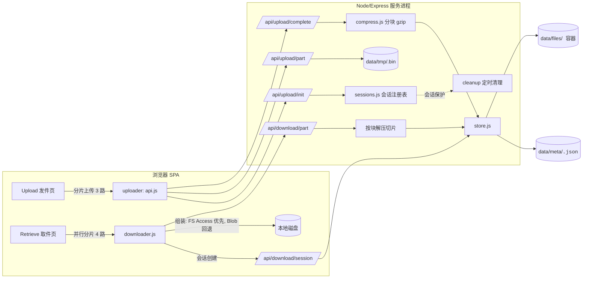

# RFC-001: 存储压缩与分片并行传输（传输域）

> Status: Implemented (Completed 2026-10-12；§4.1 存储容器已被 RFC-002 取代，其余章节有效) | Type: RFC | Created: 2026-10-12 | Updated: 2026-10-12 | Authors: zwh | Reviewers: zwh | Target: v1.1.0 传输优化
> 索引：`RFC-001`（本项目首份 RFC） | 关联 REQ：REQ-001~REQ-008 | 收益：可压缩文件磁盘占用 ≤30%（分块 gzip），上传/下载支持 4 路分片并行（大文件吞吐提升，消费计数不重复扣减）
> 位置：`docs/rfc/RFC-001-compression-chunked-transfer.md` 权威；`docs/superpowers/specs/2026-10-12-compression-chunked-transfer-design.md` 为实现快照
> 一致性声明：本文档与 ADR-001（压缩策略）、ADR-002（分片协议）、ADR-003（浏览器组装）保持一致；与既有开发规范 `docs/DEVELOPMENT.md` 不矛盾（新增接口与数据字段均已登记）。后续变更需先更新本文档再改代码。

## 0. 更新摘要

2026-10-12（RFC-002 接续）：**§4.1 的「固定 4MB 块 gzip 容器」已被 `RFC-002` + `ADR-004/005` 取代**——改为自适应单元 + 内容定界切分 + 单元级去重 + raw/gzip/brotli 择优，并把存储态编码按 `Accept-Encoding` 直传（`ADR-006`）。本文档的**分片会话协议（§4.2）**、**会话保护与消费语义（§4.3）**、错误语义（§5）**继续有效且未改动**；旧容器 `gzip-blocks` 数据在新版本下只读兼容（无需迁移），升级为单向门（新容器不被旧构建识别）。

2026-10-12：实现完成（提交 `414bb78`、`0fbc1c0`）：服务端压缩 + 分片会话接口、前端分片上传/并行下载、管理端开关与节省展示；`npm test` **145 passed / 0 failed**，`npm run build` 通过，Chrome headless CDP 浏览器冒烟 3/3。

2026-10-12：首版。定义两种传输算法并解决二者的组合冲突：①分块 gzip 压缩容器（降低磁盘占用，且支持按原始字节范围随机读取）；②gopeed 式分片并行传输本地化（上传 init/part/complete，下载 session/part，会话制消费计数）。核心收束点：**分片按原始字节范围寻址，服务端对压缩容器按块解压切片**，使压缩与并行正交组合；**下载消费按会话计 1 次而非按请求计**，并在会话存续期保护文件不被清理。

## 1. 需求

| REQ | 目标 | 基线 | 目标 | 验证 |
|---|---|---|---|---|
| REQ-001 | 分块 gzip 压缩降低磁盘占用 | 无压缩，storedSize = size（`server/store.js` commitUpload） | 可压缩文件（512KB 重复文本）storedSize ≤ 30% × size | `npm test` 用例 [17]，读取 `data-test/meta/<code>.json` 断言 |
| REQ-002 | 压缩文件下载逐字节一致 | 不适用 | 下载内容与上传逐字节相等，中文文件名 header 正常 | `npm test` 用例 [17] |
| REQ-003 | 无收益回退不膨胀 | 不适用 | 不可压缩内容 storedSize = size 且 `compression=''` | `npm test` 用例 [17] |
| REQ-004 | 压缩可开关 | 无开关 | `compressionEnabled=false` 时 storedSize = size，改回 true 后恢复 | `npm test` 用例 [17] |
| REQ-005 | 分片并行上传 | 单请求 multer 全量上传（`server/index.js` makeUpload） | init/part/complete 乱序分片上传成功且内容一致 | `npm test` 用例 [18] |
| REQ-006 | 分片并行下载 | 单连接 `res.download` | 会话+并发分片取回拼接一致，且消费计数仅 +1 | `npm test` 用例 [19] |
| REQ-007 | 会话期文件保护 | 消费耗尽即被 getActive/cleanup 物理删除 | maxDownloads=1 时会话内 part 可取；`/end` 后正常回收 | `npm test` 用例 [19] |
| REQ-008 | 错误语义与零回归 | 100 passed（2026-10-12 实测 `npm test`） | 新增 409/413/400/404 用例；既有 100 用例全绿 | `npm test`（全量） |

> 基线环境：Windows（Git Bash），Node ≥18 ESM，`npm test` 自启服务器（端口 3999，`MAX_FILE_SIZE=1048576`，`TRANSFER_PART_SIZE=262144` 测试覆盖）。

## 2. 现状根因

- **无压缩**：`server/store.js` `commitUpload()` 将 multer 落盘的 tmp 文件直接 `renameSync` 进 `data/files/<code>`，磁盘占用恒等于原文件大小；`data/settings.json` 也没有压缩相关开关。Telegram/网盘类产品对文本、日志、文档的压缩收益（gzip 典型 3~10 倍）完全未利用。
- **单请求上传**：`server/index.js` `makeUpload()` 用 multer 单请求接收整个文件（diskStorage → `data/tmp/`），大文件只能单连接串行传输，无分片、无并行、中途失败需整体重传。
- **单连接下载**：`server/index.js` `/api/download` 直接 `res.download()` 全量发送；没有并行分片入口。
- **消费计数为请求级**：`/api/download` 每被请求一次就 `tryConsume()` 一次（`server/index.js`）。若直接复用 HTTP Range 对同一文件发 N 个分片请求，会瞬间扣光下载次数并触发限流——这是任何并行下载方案必须先解决的第一约束。
- **消费耗尽即删除**：`store.getActive()` 与 `cleanupExpired()` 在 `downloads ≥ maxDownloads` 时立即物理删除文件。并行下载的会话期内若文件被删，分片将 404——第二个必须先解决的约束。

## 3. 总体设计



两条算法在数据面上的关系：

1. **压缩在前**：上传 complete 时，服务端把组装好的原始文件按 4MB 块独立 gzip，写为"块容器"（连续存放 + meta 索引）；每块取 gzip/原样中较小者，整体无收益则放弃压缩存原始文件。容器仍是单文件、单路径，有效期/次数/删除语义不变。
2. **分片在后**：上传与下载的分片一律按**原始字节范围**寻址。下载分片时服务端查块索引，只解压与范围相交的块后切片返回——不需要为并行下载解压整个文件，压缩与并行因此正交组合。
3. **gopeed 本地化映射**：连接数 4、分片 4MB（env 可调）、分片失败重试 2 次、任务 = 下载会话（token）、chunk = part（按原始偏移）、单线程回退 = 现有直链下载（小文件 / 浏览器不支持时保留）。gopeed 的"断点续传/暂停恢复"本期不做（见 §7 非目标）。

## 4. 详细设计

### 4.1 分块 gzip 容器（REQ-001~004）

> 已被 `RFC-002` §4.1 取代（自适应单元容器 + 去重 + 多编解码）：以下 4MB 固定块设计与 `blockSize`/`blocks` 字段保留为**旧数据只读兼容**说明，新数据一律写 `units-v2`。

新增 `server/compress.js`：

- `isCompressible(mime, filename)`：按 MIME 前缀与扩展名跳过已压缩格式（`image/jpeg|png|gif|webp|avif|heic`、`video/*`、`audio/*`、`zip|rar|7z|gz|xz|zst|bz2` 等）；其余尝试压缩。
- `compressInPlace(filePath)`：按 `BLOCK_SIZE = 4MB` 逐块读取原始文件 → 异步 `zlib.gzip`（不阻塞事件循环）→ 每块取 `min(gzip, raw)`；全部块写入 `<filePath>.pack` 后：
  - 若 `总存储 ≥ 原大小` → 删除 `.pack`，返回 `{ ok: false }`（保持原始文件，绝不膨胀）；
  - 否则 `renameSync(.pack → filePath)`，返回 `{ ok: true, storedSize, blocks }`。
- 容器结构：`files/<code>` 为各块依次拼接；meta 存索引：

```json
{
  "compression": "gzip-blocks",
  "blockSize": 4194304,
  "blocks": [ { "o": 0, "c": 1234, "r": 4194304, "z": 1 } ],
  "storedSize": 45678
}
```

  - `o` = 容器内偏移，`c` = 存储字节数，`r` = 原始字节数，`z` = 1 表示 gzip、0 表示原样；`storedSize` 恒有值（未压缩 = size），旧数据无该字段视为未压缩（向后兼容）。
- `readRange(filePath, meta, start, end)`：定位相交块 → 读存储字节 → `gunzip`（异步）→ 按原始偏移切片拼接（内存 O(blockSize + 请求范围)）。
- `streamOriginal(res, filePath, meta)`：单连接下载时逐块解压流式写出，`Content-Length = meta.size`、`Content-Disposition: attachment`（含 `filename*=UTF-8''`），写背压用 `drain` 处理。

接线点：

- 单请求上传（`server/index.js` `/api/upload`）与分片上传（4.2）在 `commitUpload` 前都调用 `maybeCompress(path)`（受设置开关与 `isCompressible` 控制）；`commitUpload(tmpFile, info)` 接受可选压缩字段写入 meta（`server/store.js`）。
- 单连接下载：`meta.compression` 存在时改用 `streamOriginal`，否则保持 `res.download`。
- 站点设置新增 `compressionEnabled`（默认 true，`server/settings.js`，管理端可关）；`/api/health` 增加 `compression` 标记。

### 4.2 分片上传协议（REQ-005）

新增 `server/transfer.js`（路由注册 `registerTransferRoutes(app)`）与 `server/sessions.js`（纯内存会话注册表，不依赖 store，避免循环引用）。

| 方法 | 路径 | 契约 |
|---|---|---|
| `POST` | `/api/upload/init` | JSON：`{ filename, size, mime, expiresIn, maxDownloads, note, customCode, password }`。校验：size ∈ [1, effectiveMaxFileSize]（超限 413）、后缀黑名单 400、自定义码 6 位且未被占用（409，受 `customCodeEnabled` 开关）、`totalParts = ceil(size/partSize) ≤ 1024`。创建内存会话 `{ uploadId, partSize, totalParts, received }`（TTL 30 分钟），返回 `{ uploadId, partSize, totalParts }`。**上传限流（rateGuard）只在 init 计一次**——一次上传 = 一个会话，分片请求不再计数。 |
| `PUT` | `/api/upload/part?uploadId=&index=` | 原始字节 body，`express.raw` 上限 = `partSize`（超出 413）。校验会话存在 404、index 合法 400、body 长度与预期分片长度严格相等 400。按 `index × partSize` 偏移写入 `data/tmp/<uploadId>.bin`（乱序/重试幂等覆盖），返回 `{ ok, received }`。 |
| `POST` | `/api/upload/complete` | JSON `{ uploadId }`。校验分片齐全 400、文件实际大小与声明一致 400；执行 4.1 压缩；`commitUpload` 落位（自定义码竞争时 409）；清理会话与 tmp。返回 201（与既有上传响应同构，额外含 `storedSize`、`compressed`）。 |

- 前端 `web/src/api.js` 新增 `uploadChunked(file, fields, onProgress)`：并发 3 路、每片重试 2 次（指数退避）、聚合进度回调；`Upload.jsx` 在 `file.size > 1MB` 时走分片，否则保留原 XHR 单请求路径。
- 失败模式：任一分片最终失败 → 抛出错误、`Upload.jsx` 提示；上传会话由 TTL 清理（`data/tmp/<uploadId>.json` 位图 + `<uploadId>.bin`，启动时恢复未过期会话并删除孤儿）。**跨页面刷新/重启续传已由 RFC-003 实现**（原为 backlog B1-1）。

### 4.3 下载会话与并行分片（REQ-006~007）

| 方法 | 路径 | 契约 |
|---|---|---|
| `POST` | `/api/download/session` | JSON `{ code, password }`。校验/密码/失效同 `/api/download`（missGuard 防爆破）；`tryConsume(code)` 消费 1 次；生成 token（`randomBytes(16).hex`，TTL 10 分钟，内存注册表）；返回 `{ token, partSize, filename, size, mime, expiresAt }`。 |
| `GET` | `/api/download/part?token=&start=&end=` | 校验 token 404；`0 ≤ start < end ≤ meta.size` 400；`end-start ≤ partSize` 400。**不调用 getActive、不重复计数**：直接读 meta（`store.getMeta`）。未压缩 → `createReadStream(target, { start, end: end-1 })` 流式；已压缩 → `readRange` 解压切片。返回精确 `Content-Length` 的 200。 |
| `POST` | `/api/download/end` | JSON `{ token }`，幂等释放会话；随后若分享已不活跃（次数耗尽/过期）立即物理回收。 |

**会话保护**（REQ-007 的关键）：`store.getActive()` 与 `cleanupExpired()` 在删除失效分享前检查 `hasActiveSession(code)`；会话存续期只标记失效、不物理删除。`transfer.js` 60s 周期清扫过期会话，对每个过期 token 执行"无活跃会话且已不活跃 → `removeShare`"。效果：maxDownloads=1 时，会话期间分片全部可取；`/end` 或 TTL 后文件正常销毁（最迟 TTL+清扫间隔）。

**消费语义**：以"下载会话"为一次消费（等价 gopeed 的 task），无论请求多少分片只扣 1 次；创建会话即扣减（即使中途放弃），与现有"开始下载即消耗 1 次"语义一致。

### 4.4 前端并行下载组装（REQ-006）

新增 `web/src/downloader.js`（ADR-003 决策）：

- `parallelDownload({ code, password, onProgress })`：①创建会话 ②按 `partSize` 切片、并发 4 路 fetch 分片（每片重试 2 次、`AbortController` 支持取消）③组装：
  - 优先 `window.showSaveFilePicker` + `createWritable`（Chromium）：按序流式写盘，内存 O(并发 × 分片大小)；
  - 回退：聚合 ArrayBuffer → `Blob` → `a[download]` 触发保存（内存 O(文件大小)，适用于非 Chromium 与大文件的取舍见 ADR-003）。
- 进度 = 已完成分片字节 / 总字节（含速率），接入 `Retrieve.jsx` 的 `Progress` 展示；完成后刷新 `/api/info`（消费次数变化）。
- `Retrieve.jsx`：`size > 1MB` 走并行下载；否则保留直链 `window.location.href = downloadUrl`（小文件免会话开销）。两种路径都保留"下载成功消耗 1 次"文案。

### 4.5 配置、设置与可观测（REQ-008）

- 新增环境变量 `TRANSFER_PART_SIZE`（默认 4194304）：上传分片上限、下载单分片上限；测试环境设为 262144 以覆盖多分片路径。必须同步 `.env.example` 与 `docs/DEVELOPMENT.md` §4。
- `settings.json` 新增 `compressionEnabled`；`/api/settings` 公开返回；管理端设置页新增开关。
- `/api/admin/list` 每项增加 `storedSize`、`compressed`；`/api/admin/stats` 增加 `totalStoredSize`、`savedBytes`（= totalSize − totalStoredSize），仪表盘展示"实际占用 / 节省"。
- `/api/health` features 增加 `compression`、`chunkedUpload`、`parallelDownload`、`downloadSession`。

## 5. 错误处理与可观测性

| 失败模式 | 行为 |
|---|---|
| 分片上传会话不存在/过期/服务器重启 | part/complete 返回 404 `上传会话不存在或已过期`；前端提示重新上传 |
| 分片 body 超限 | 413（express.raw 的 entity.too.large 映射为中文 JSON） |
| complete 时自定义码被抢占 | 409，与单请求上传一致；前端弹窗询问是否自动生成 |
| 下载 token 过期（TTL 10min） | part 返回 404；客户端中止并提示重新下载（会话已消费，与放弃下载语义一致） |
| 下载分片范围非法/过大 | 400，附中文提示 |
| 压缩过程失败（磁盘/权限） | 放弃压缩、保留原始文件继续 commit（压缩是增强不是依赖）；错误写入日志 |
| 会话期文件被误删 | 不会发生：getActive/cleanup 均受会话保护；`/end` 与 TTL 清扫负责最终回收 |
| 限流 | init 与 session 创建沿用 rateGuard/missGuard；part 接口不重复计数，防"并行把自己限流" |

## 6. 验收

| REQ | 结果 | 证据 |
|---|---|---|
| REQ-001 | ✅ 通过 | 用例 [17]：512KB 重复文本压缩后 storedSize 544B（0.10%，门槛 ≤30%） |
| REQ-002 | ✅ 通过 | 用例 [17]：压缩文件下载逐字节一致；Content-Length = 原始大小 |
| REQ-003 | ✅ 通过 | 用例 [17]：100KB 随机二进制 storedSize = size 且 compression = '' |
| REQ-004 | ✅ 通过 | 用例 [17]：compressionEnabled=false 不压缩；恢复 true 后重新压缩 |
| REQ-005 | ✅ 通过 | 用例 [18]：600KB 分 3 片乱序上传 → 201 且下载一致；409/413/400 共 7 例错误语义 |
| REQ-006 | ✅ 通过 | 用例 [19]：3 片并发拼接一致；downloads 0→1 且分片请求后仍为 1 |
| REQ-007 | ✅ 通过 | 用例 [19]：maxDownloads=1 耗尽后 info 404 但分片可取；/end 后文件与 meta 回收 |
| REQ-008 | ✅ 通过 | 全量 `npm test`：145 passed / 0 failed（基线 100 + 新增 45）；`npm run build` 成功；浏览器冒烟 3/3 |

## 7. 非目标

- **断点续传/跨刷新恢复**：gopeed 的 resume 需要持久化分片位图与目标文件随机写，浏览器端实现成本高；先做单次会话内重试，续传列 backlog B1-1（**2026-10-12 已由 RFC-003 实现**：上传位图落盘 + 下载会话续传）。
- **标准 HTTP Range（206）语义**：与"一次消费=多个请求"的扣减模型冲突；应用层 part 协议更可控，标准 Range 仅在未来单连接续传场景再评估。
- **P2P / 局域网直传**：改变服务模型（中转站），超出本期。
- **服务端后台压缩队列**：本期在 complete 时同步-异步压缩（量级 100MB 内可接受），压缩任务化列 backlog B1-2。
- **内容加密**：取件密码仅是门禁（SHA-256 校验），不是端到端加密；不在本期。
- **zstd/外部压缩库**：Node 无内置 zstd，项目约定优先零依赖（ADR-001 已否决）。

## 8. 追溯

> 实现追溯：提交集 `414bb78..0fbc1c0`（`master` 分支；Task 1+2 合并为一次服务端提交 `414bb78`，前端 `0fbc1c0`，文档 Task 4 另行提交）。TDD：先写 `scripts/test.js` 用例 [17]~[19]（45 断言）后实现，全量回归 `npm test` **145 passed / 0 failed**（2026-10-12，Windows Git Bash/Node ≥18 ESM，测试端口 3999、`TRANSFER_PART_SIZE=262144`）；`npm run build` 成功；Chrome headless（CDP）浏览器冒烟：首页/取件页/管理端 3/3 渲染通过。任务与提交对应见 `docs/superpowers/plans/2026-10-12-compression-chunked-transfer-plan.md`（Task 1+2 合并提交已在计划中标注）。
