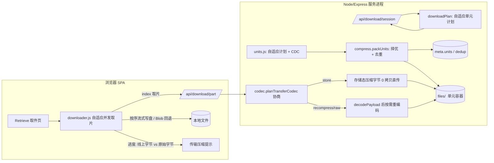

# RFC-002: 自适应单元容器与传输压缩（下载域提速）

> Status: Implemented (Completed 2026-10-12) | Type: RFC | Created: 2026-10-12 | Updated: 2026-10-12 | Authors: zwh | Reviewers: zwh | Target: v1.2.0 下载提速
> 索引：`RFC-002` | 关联 REQ：REQ-009~REQ-023 | 收益：文本类文件**线上传输字节降到 16%~44%**（实测），下载分片尺寸随文件自适应（不再固定），浏览器网络层自动解压（前端零解压代码）
> 位置：`docs/rfc/RFC-002-adaptive-units-transfer-compression.md`（权威）；实现计划追溯快照 `docs/superpowers/plans/2026-10-12-adaptive-units-plan.md`（执行期未留独立计划，落地后按最终提交补写，backlog B3-2 关闭）；关联 `ADR-004`（自适应单元 + CDC）、`ADR-005`（多编解码 + 去重）、`ADR-006`（传输压缩协商）、`ADR-007`（传输节省统计口径）、`ADR-008`（编码候选开关）、`ADR-009`（统计写入批量聚合）、`ADR-010`（维度数据与保留策略）、`ADR-011`（导出与清零的权限/审计口径）
> 一致性声明：与 ADR-004~011 一致；`docs/DEVELOPMENT.md` §5/§7/§13 已登记（数据字段、接口契约、机制说明）。**本 RFC 取代 RFC-001 §4.1 的"固定 4MB 块 gzip 容器"**；RFC-001 的分片会话协议、消费语义、会话保护继续有效且未改动。

## 0. 更新摘要

2026-10-12 增量四（REQ-023，closure of backlog B4-9）：**传输维度明细的导出与清零**——新增 `GET /api/admin/stats/export`（CSV 长表：UTF-8 BOM + RFC 4180 转义，全量 30 天 + 全部文件条目，文件名关联分享）与 `POST /api/admin/stats/reset`（`{ confirm: true }`，重置站点传输累计与全部明细并记录 `resetAt`/`resetCount` 审计，不影响上传/下载次数）；同时修复 `recordUpload`/`recordDownload` 会连带丢弃未刷盘维度增量的问题（ADR-011）。`npm test` **231 passed / 0 failed**（新增 19 条：导出契约/转义/BOM/权限、清零/审计/继续计量、维度增量保留）、`npm run e2e` **29 passed / 0 failed**（新增 8 条：E2E-7 真实浏览器点击导出落盘 CSV 与点击清零后界面归零）。

2026-10-12 增量三（REQ-022，closure of backlog B4-6）：**传输节省的按日/按文件维度**——新增单例 `data/transfer-stats.json`（与站点计数共用刷盘窗口，仅在有增量或墓碑时写）；日期按服务器本地日切分并保留最近 30 天，文件条目随分享销毁回收并封顶 2000；`/api/admin/stats` 新增 `transferToday`/`transferDays`（近 7 日），`/api/admin/list` 每项新增 `transfer`；仪表盘加“今日”行与「近 7 日传输节省」明细卡，文件管理页加「传输节省」列（ADR-010）。`npm test` **212 passed / 0 failed**（新增 9 条）、`npm run e2e` **21 passed / 0 failed**（新增 3 条：今日行、近 7 日首行为今日、文件管理列）；线上实测 3.9MB/15 片：今日桶与按文件维度均即时准确，磁盘维度文件在刷盘窗口内落盘，分享销毁后条目被清理而日桶保留。

2026-10-12 增量二（REQ-021，closure of backlog B4-7）：**统计写入批量聚合**——`recordTransfer` 只累加内存 `pending`，`readCounters()` 合并未落盘增量（读取永不陈旧），达 32 片或每 2s 刷盘一次，`SIGINT`/`SIGTERM` 优雅退出时显式刷盘（ADR-009）。实测：18 片的下载接口侧即时准确，磁盘在 1250ms 内收敛（窗口内同步写 0 次、随后 1 次，此前为 18 次）。同时把开发环境数据目录与生产隔离（`scripts/dev.js` 默认 `DATA_DIR=data-dev`，消除多进程共享 `data/` 时会话跨进程无保护的风险）。`npm test` **203 passed / 0 failed**（新增 8 条）、`npm run e2e` **18 passed / 0 failed**。

2026-10-12 增量（REQ-019/020，closure of backlog B4-1）：**传输节省落库 + 仪表盘卡片**与**管理端编码候选开关**。新增 `stats.recordTransfer()`（分片产出时累计原始/线上字节，会话内同一取片键只计一次，节省值派生不落盘）、`session.markSessionPart()`、`settings.compressionCodecs`（生效值 = 设置 ∩ env 上限）与 `getCompressionCodecs()`；`/api/admin/stats` 新增 `transferOriginalBytes`/`transferWireBytes`/`transferSavedBytes`，`/api/settings` 新增 `compressionCodecs`/`compressionCodecCap`，`/api/health` 新增 `transferStats`/`codecToggle`；`/admin` 仪表盘新增「传输节省」卡片（含线上/原始副行），设置页新增编码候选切换。`npm test` **195 passed / 0 failed**（新增 13 条：传输累计与去重、候选开关与非法值回退、健康标记）；`npm run e2e` **18 passed / 0 failed**（新增 E2E-6：真实浏览器登录管理端，卡片与接口数值核对一致）。详见 ADR-007/ADR-008 与 `docs/DEVELOPMENT.md` §5/§7/§13.7。

2026-10-12：实现完成（服务端 `ba57346`、前端 `719b9c5`、测试 `40494c9`，文档本提交）：自适应单元容器（内容定界切分 + 单元级去重 + raw/gzip/brotli 择优）、服务端下发分片计划、分片按 `Accept-Encoding` 直发存储态编码（浏览器自动解压）、客户端自适应并发。`npm test` **182 passed / 0 failed**（RFC-001 基线 145，新增 37 条对抗断言）；`npm run e2e`（新增）**15 passed / 0 failed**；`npm run build` 通过；线上实例（本机 3002）实测 2MB 日志类文件存储 44.3%、传输省 55.7%、逐字节一致。

2026-10-12 首版需求：把"压缩"从**只省磁盘**扩展到**也省带宽**，并把"固定分片"改成**按文件与内容自适应**。

## 1. 需求

| REQ | 目标 | 基线（RFC-001 后） | 目标 | 验证 |
|---|---|---|---|---|
| REQ-009 | 压缩数据真正走线（省带宽） | `readRange()` 在服务端 gunzip 后发原始字节，线上字节 = 原始大小 | 文本类文件线上字节 ≤ 60% 原始 | `scripts/test.js` [21] 汇总 `Content-Length` 断言；`e2e-browser.js` 用 resource timing `encodedBodySize/decodedBodySize` 双证 |
| REQ-010 | 浏览器端自动解压且逐字节一致 | 无（只有原始字节） | 前端零解压代码；落地文件哈希 = 原文件哈希 | `e2e-browser.js`：Blob 组装路径与 OPFS 流式写盘路径各验一次 SHA-256 |
| REQ-011 | 未声明支持则绝不压缩（安全红线） | 不适用 | `identity` / 仅 `deflate` / `q=0` / 通配 `q=0` / **无 `Accept-Encoding` 头** ⇒ 无 `Content-Encoding` 且字节一致 | `scripts/test.js` [20] 协商矩阵 13 例 + [21] 六种客户端画像逐分片断言 + 裸 `http.request`（无该请求头）断言 |
| REQ-012 | 压缩机制非"整文件过一遍 gzip" | 固定 4MB 块、单一 gzip、无去重 | 内容定界切分（CDC）+ 单元级去重 + 多编解码逐单元择优 | `scripts/test.js` [20] CDC 两套实现互证/边界/片数上限、去重与永不膨胀；[21] 去重单元载荷恒等断言 |
| REQ-013 | 下载分片自适应（非固定） | 固定 `TRANSFER_PART_SIZE`（4MB） | 片数与片大小随文件自适应，且有上下限与片数上限保护；客户端按服务端计划取片 | `scripts/test.js` [20] 尺寸扫描（1B~300MB × 两套配置）、[21] 会话计划与服务端容器一致 |
| REQ-014 | 存储态 0 拷贝直传 | 不适用 | 协商通过时不发生二次压缩（`X-Transfer-Mode: store`） | [21] 断言存在 `store` 分片（br 与 gzip 两处：gzip 在 [23] 旧容器用例） |
| REQ-015 | 旧容器零迁移兼容 | `gzip-blocks` + `blocks` 为唯一格式 | 旧数据无需迁移即可导航下载与分片下载 | `scripts/test.js` [23] 手工构造旧容器 meta/文件后全路径验证 |
| REQ-016 | 完整性红线：宁可不服务也不发可疑字节 | 无校验 | 单元表不覆盖 `size`、或载荷超出实际文件大小 ⇒ `500 文件损坏`；客户端分片长度不符即中断 | `scripts/test.js` [22] 改坏 `units[0].r`、截断文件体（index 与 start/end 两种取法） |
| REQ-017 | 可测的提速 | 无对照 | 限速链路下并行+压缩明显快于单流基线 | `e2e-browser.js` E2E-3：同链路 12.5MB/s A/B |
| REQ-018 | 零回归 + 对抗用例 | 145 passed / 0 failed | 既有用例全绿，新增对抗矩阵 | `npm test` 全量 + `npm run e2e` |
| REQ-019 | 传输节省可累计、可在管理端看到 | 传输节省仅存于响应头与前端进度，刷新即失 | `stats.json` 累计原始/线上字节，仪表盘出卡片（节省字节 + 省百分比） | `scripts/test.js` [24] 增量断言（原始 = 文件大小、线上 = `Content-Length` 之和、重复取片不重复计）；`scripts/e2e-browser.js` E2E-6 登录后卡片与接口一致 |
| REQ-020 | 压缩 CPU 吃紧时可降级，无需改 env 重启 | 只能改 `COMPRESS_CODECS` 并重启进程 | 管理端开关在 env 上限内收窄为「仅 gzip」，即时对新上传生效 | `scripts/test.js` [24]：仅 gzip 时单元无 `b`、非法值回退、恢复双试；`/api/settings` 返回生效值与 env 上限 |
| REQ-021 | 统计写入不随分片数线性放大，且读取不陈旧 | 每分片一次同步读-改-写 `stats.json`（单文件最多 256 次） | 写入次数压到 `ceil(片数/32)`；读接口始终返回含未落盘增量的最新值 | `scripts/test.js` [24] 磁盘滞后不超前 + 4s 内收敛；[24b] 阈值刷盘/合并读/余量不丢；线上实测 18 片 → 窗口内 0 次写、1250ms 收敛 |
| REQ-022 | 传输节省可按日期/文件查询，且有明确保留策略 | 只有站点级累计，无法回答“哪天/哪个文件省了多少” | 日维度保留 30 天、文件维度随分享销毁回收并封顶；管理端出及时明细 | `scripts/test.js` [24c] 今日桶/近 7 日/按文件维度/销毁后失效；[24b] 30 天裁剪与 2000 条封顶；`scripts/e2e-browser.js` E2E-6 三项界面断言 |
| REQ-023 | 传输维度明细可归档（CSV 导出）与可重开计量（清零），审计事实可查 | 管理端只能查看，近 7 日之外与全文件明细无法带走，也不能清零 | 导出全量 30 天 + 全部文件条目的 CSV（BOM + RFC 4180）；一键清零（含未刷盘增量）并保留上传/下载次数；记录 `resetAt`/`resetCount` | `scripts/test.js` [24d]（权限 401/400、附件头与 BOM 字节、转义文件名、清零归零、审计可见、非传输计数不变、清零后继续计量）；`scripts/e2e-browser.js` E2E-7（真实点击导出落盘 CSV 与点击清零后界面归零） |

> 基线环境：Windows（Git Bash），Node 24 ESM（要求 ≥18），`npm test` 自启服务器（端口 3999，`MAX_FILE_SIZE=1048576`，`TRANSFER_PART_SIZE=262144`，`UNIT_TARGET_COUNT=8`、`UNIT_MIN_SIZE=65536`、`UNIT_MAX_SIZE=262144`、`UNIT_MAX_COUNT=64` 以覆盖多片路径）。

## 2. 现状根因

- **压缩只省磁盘**：RFC-001 §4.1 的 `readRange()` 在服务端把相交块 gunzip 后发出，线上传输的仍是原始字节；`/api/download` 同样逐块解压后流式输出。换言之磁盘省了 60%~80%，带宽一点没省。
- **分片固定 4MB**：与文件大小无关——4MB 文件只有 1 片（等于没有并行），300MB 文件在并发 4~8 下"尾部拖尾"明显；分片还偏大时"最后一片独自跑完、其余通道空转"。
- **块边界与内容无关**：固定 4MB 边界使"平移后的重复内容"落在不同块，无法识别为同一份数据；gzip 32KB 窗口也无法跨块复用。
- **单一 gzip**：文本上 brotli 普遍更小（实测源码语料小 5%~14%），不用是白扔体积和带宽。

## 3. 总体设计

三层要点：

1. **存储层**：上传完成时按自适应单元切分（CDC），逐单元在 raw/gzip/brotli 中取最小并做单元级去重，写成"单元容器"（连续存放 + `meta.units` 索引）。无收益整体放弃，存原始文件。
2. **传输层**：分片按原始字节范围寻址（RFC-001 的寻址模型不变），但服务端按 `Accept-Encoding` 把**存储态压缩字节原样发出**并附 `Content-Encoding`，浏览器网络层解压；不支持时解压后发原始字节。一个分片恒等于一个压缩成员（存储态）或一个重编码成员（任意范围），因此不依赖多成员流。
3. **客户端层**：不再自行按 `partSize` 切片，而是照服务端下发的 `units` 计划按 `index` 取片；并发按"内存预算 + 建议值 + 实测反馈"自适应，组装保持按序流式写盘。

## 4. 详细设计

### 4.1 自适应单元容器（REQ-012/013，ADR-004）

新增 `server/units.js`：

- `chunkPlan(size, cfg)`：`unit = clamp(ceil(size / UNIT_TARGET_COUNT), UNIT_MIN_SIZE, UNIT_MAX_SIZE)`；`ceil(size/unit) > UNIT_MAX_COUNT` 时 `unit = ceil(size / UNIT_MAX_COUNT)`，片数始终 ≤ 上限。
- `chunkBounds(size, cfg)`：`min = max(floor(unit/4), 16KB)`、`avg = unit`、`max = unit`（单元长度恒 ≤ `UNIT_MAX_SIZE`，除非片数上限倒逼放大）。
- `chunkFile(fd, size, opts)` / `chunkRanges(buffer, opts)`：Gear-hash 内容定界切分，`h = (h << 1) + GEAR[byte]`，切点 `len ≥ min 且 (h & mask) == 0`（`mask = 2^round(log2(unit - min)) - 1`），切后哈希归零；超过 `maxCount` 返回 `null`（上层回退 `uniformRanges`）。
- `unitRanges(units)`：由 `Σr` 前缀和推导分片原始范围；`unitsCoverage(units, size)`：校验"顺序、无空洞、Σr === size、`o/c/r` 合法"。

新增 `server/codec.js`（ADR-005）：`encodeUnit`（raw/gzip(6)/brotli(5) 取最小，brotli 需小 4% 以上）、`decodePayload`、`parseAcceptEncoding`/`acceptsEncoding`/`planTransferCodec`（协商）。

`server/compress.js` 重写为容器模块：

- `packUnits`：读 → 按 CDC 边界切 → 单元哈希去重（`Map<hash, index>`）→ 择优编码 → 写 `<file>.pack` → 整体有收益才 `renameSync` 覆盖（否则删除 `.pack` 保留原件）；失败路径关闭 fd 并清理临时文件。
- meta（`server/store.js`，`COMPRESSION_FORMAT = 'units-v2'`）：`compression`、`storedSize`、`units: [{o,c,r,z,d?}]`、`dedup`；旧 `blocks`（`z: 0|1`）在读取时归一化为 `r/g`，**只读兼容、不迁移**。
- `downloadUnits(meta)`：未压缩返回 `null`；容器损坏（`unitsCoverage` 不通过）抛 `META_CORRUPT`，由路由转 `500 文件损坏，请联系管理员`。
- `downloadPlan(meta, cfg)`：压缩文件 = 既有单元（`unitRanges`）；未压缩文件 = `downloadRanges` 均匀自适应切片。两条路径都产出 `{ compressed, units, ranges }`。
- `readUnit` / `readRanges`（按单元或任意范围解码）、`streamOriginal`（单流导航下载逐单元解压写出）、`unitPayloadFits`（`o + c ≤ 实际文件大小`）。

### 4.2 传输压缩与协商（REQ-009~011/014，ADR-006）

`/api/download/session`（`server/transfer.js`）：在 `tryConsume` **之前**先算计划（容器损坏时不消费次数），返回 `{ token, partSize, filename, size, mime, expiresAt, compressed, units, unitCount, parallel }`；`parallel = clamp(ceil(unitCount/6), 2, 8)`。

`/api/download/part`：

- `index`（计划内，推荐）或 `start/end`（任意范围，`end - start ≤ TRANSFER_PART_SIZE`，兼容旧前端缓存）。
- 计划生成后立即校验"所有单元载荷都在文件大小内"，否则 `500`（截断/损坏防线）。
- 协商结果三态：`store`（存储态 0 拷贝直传）、`recompress`（解压后重编码，仅在存储编码不被接受但 gzip/br 被接受时）、`raw`（原始字节）。响应头：`Content-Encoding`（仅压缩时）、`X-Transfer-Mode`、`X-Transfer-Codec`、`X-Transfer-Part`、`X-Transfer-Algo`、`Vary: Accept-Encoding`、`Cache-Control: private, no-store`。
- 未压缩文件：校验 `end ≤ 实际文件大小` 后 `createReadStream` 精确切片，并显式给 `Content-Length`（避免分块传输，客户端可自校验）。

### 4.3 客户端取片与并发（REQ-013/016）

`web/src/downloader.js`：

- `planRanges(session)`：优先用 `session.units`（缺失才回退 `partSize` 均匀切片），取片一律 `?index=`。
- `initialConcurrency`：`min(session.parallel, floor(32MB / 平均单元大小), 8)`，下限 1；运行中每成功 3 片并发 +1（上限 8），失败降半（下限 2）。
- 每个分片校验 `byteLength === end - start`，不符即中断并保留首个真实错误（外部取消仍报"已取消"）。
- 组装保持"按序流式写盘（FS Access）"或"Blob 回退"，并在 `onProgress` 里带上 `wire`（线上字节）与 `codec`，供取件页展示"传输压缩 gzip/brotli · 线上字节 · 已省 X%（浏览器自动解压）"。

### 4.4 配置与可观测（REQ-018）

- 新增环境变量：`UNIT_TARGET_COUNT`（32）、`UNIT_MIN_SIZE`（256KB）、`UNIT_MAX_SIZE`（8MB）、`UNIT_MAX_COUNT`（256）、`COMPRESS_CODECS`（`br,gzip`）；已同步 `.env.example` 与 `docs/DEVELOPMENT.md` §4。
- `/api/health` features 新增 `transferCompression`、`adaptiveChunking`、`unitDedup`、`multiCodec`。
- `/api/admin/stats` 的 `totalStoredSize`/`savedBytes` 语义不变（仍为磁盘节省）；**新增** `transferOriginalBytes`/`transferWireBytes`/`transferSavedBytes`：分片下载链路每次成功产出分片时累计（`stats.recordTransfer`，会话内同一取片键只计一次），节省值为「原始 − 线上」的派生结果，不重复落盘（ADR-007）。
- **管理端编码候选开关**：`settings.compressionCodecs`（`br,gzip` / `gzip`，默认双试）经 `getCompressionCodecs()` 与 env `COMPRESS_CODECS` 求交后交给 `maybeCompress({ codecs })`；env 是硬上限，交集为空回退 `gzip`；只影响此后新上传的文件（ADR-008）。
- `/api/health` features 追加 `transferStats`、`codecToggle`，便于部署自检（Grafana/巡检脚本据此判断新旧版本）。

## 5. 错误处理与可观测性

| 失败模式 | 行为 |
|---|---|
| 单元表不覆盖 `size`（meta 被改坏） | 会话创建/取片/导航下载均 `500 文件损坏，请联系管理员`；**不**静默按原始文件输出（否则会输出压缩字节） |
| 文件体被截断（载荷越界） | 取片前统一校验 `o + c ≤ 实际文件大小` ⇒ `500`；客户端分片长度校验双保险 |
| 客户端不支持任何压缩 | 无 `Content-Encoding`，服务端解压后发原始字节（正确性优先） |
| 客户端只支持 gzip、存储为 brotli | 解压 + 重压 gzip 后发出（`Mode: recompress`），有 CPU 成本但保证兼容 |
| 客户端声明 `br` 但存储为 gzip | 直接发 gzip（gzip 也在被接受集合内），不重编码 |
| 分片序号/范围非法 | `400`（越界、负数、非数字、小数序号均拒绝） |
| 压缩过程失败（磁盘/权限/编码器异常） | 放弃压缩、保留原始文件继续 commit（压缩是增强不是依赖），日志记录 |
| 客户端取消 / 页面卸载 | `AbortController` 中止在途分片，`/api/download/end` 释放会话（失败由 TTL 兜底） |

## 6. 验收

| REQ | 结果 | 证据 |
|---|---|---|
| REQ-009 | ✅ 通过 | [21] `wireTotal < 0.6 × size`；E2E-2 `encodedBodySize/decodedBodySize` 断言；线上实例 2MB 日志类文件线上 928,754 / 原始 2,097,153（省 55.7%） |
| REQ-010 | ✅ 通过 | `npm run e2e`：Blob 组装与 OPFS 流式写盘两条路径的落地文件 SHA-256 均等于原文件；Chrome 154 实测 17/17 分片 `Content-Encoding: br` |
| REQ-011 | ✅ 通过 | [20] 协商矩阵 13 例；[21] 五种画像逐分片编码断言 + 裸 `http.request`（无 `Accept-Encoding`）断言 `Mode: raw` 且字节一致 |
| REQ-012 | ✅ 通过 | [20] CDC 边界/覆盖/上限、两套实现互证、永不膨胀、brotli 边际规则；[21] 700KB 全零文件去重片数 = 片数−1 且载荷恒等 |
| REQ-013 | ✅ 通过 | [20] 1B~300MB × 两套配置的片数/覆盖性质；[21] 会话 `units` 与服务端容器逐片一致、`parallel ∈ [2,8]`；未压缩文件同样有自适应计划 |
| REQ-014 | ✅ 通过 | [21] brotli 存储态 `store` 分片；[23] 旧容器 gzip 存储态全部分片 `store`（0 拷贝） |
| REQ-015 | ✅ 通过 | [23] 手工构造 `gzip-blocks` 容器：导航下载逐字节一致、会话按块升级为分片计划、分片 gzip 直传且一致 |
| REQ-016 | ✅ 通过 | [22] 改坏 `units[0].r` 后会话与导航均 500、修复即恢复；截断文件体后 `index` 与 `start/end` 取片均 500 |
| REQ-017 | ✅ 通过 | E2E-3（12.5MB/s 限速）：传输窗口 237ms vs 单流基线 1494ms → **6.30x**；端到端（含 UI 与落盘）741ms |
| REQ-018 | ✅ 通过 | `npm test` **182 passed / 0 failed**（基线 145，新增 37）；`npm run e2e` **15 passed / 0 failed**；`npm run build` 成功；线上实例验收（上传→计划→并发取片→逐字节一致→清理）通过 |
| REQ-019 | ✅ 通过 | [24]：并发取完全部分片后 `Δ原始 = 文件大小`（352,400）、`Δ线上 = ΣContent-Length`（同值且 < 原始）、`Δ节省 = 原始 − 线上`；重复取片/越界序号后计数不变。E2E-6：真实浏览器登录 `/admin`，卡片「传输节省 26.6 MB｜线上 4.5 MB / 原始 31.1 MB · 省 86%」与 `/api/admin/stats`（4,691,564 / 32,594,304，86%）一致 |
| REQ-020 | ✅ 通过 | [24]：`compressionCodecs=gzip` 后新上传单元 `z ∈ {g,r}`（无 `b`）且仍压缩（`units.length > 1`）；`zstd,snappy` 回退 `gzip`；恢复 `br,gzip` 后压缩正常；`/api/settings` 同时返回生效值与 env 上限 |
| REQ-021 | ✅ 通过 | [24]：取片结束即刻读接口已含全部分片字节（磁盘读不超前于接口，4s 内收敛一致）；[24b] 隔离探针：未达 32 片不落盘但读取端已合并、第 32 片即时刷盘、余量留内存且读取仍最新、显式刷盘落盘余量、无增量时刷盘为空操作；线上实测 18 片窗口内磁盘写 0 次、1250ms 后收敛 |
| REQ-022 | ✅ 通过 | [24c]：今日桶 Δ原始 = 文件大小、线上 = ΣContent-Length，`transferDays` 首项为今日且 `savedBytes = 原始 − 线上`，`/api/admin/list` 单项 `parts` = 分片数，删除分享后该项消失；[24b]：墓碑项在读接口立即消失、刷盘后从文件删除，40 天前日期被裁剪、明日日期保留，2001 条时封顶 2000 且淘汰最旧；E2E-6：真实浏览器卡片“今日”行、近 7 日首行日期与接口一致、文件管理页展示「线上 / 原始」；线上实测 3,908,890B/15 片 → 今日桶与按文件维度 savesBytes 均与实测值相等，磁盘 `transfer-stats.json` 在刷盘窗口内落盘，分享销毁后条目被清理而日桶保留 |
| REQ-023 | ✅ 通过 | [24d]：未带密钥 `401`、缺 confirm `400`；导出为 `text/csv` 附件（时间戳文件名）且首字节 `EF BB BF`，表头固定，按日行与今日桶逐字段一致，按文件行含 RFC 4180 转义文件名（逗号+引号）与正确字节/片数；清零返回审计并即时落盘，累计与明细归零、上传/下载次数与文件数不变、按文件列全零、导出仅剩表头，清零后继续计量；[24b]：上传/下载计数写盘不再吞掉未刷盘维度增量，随后续刷盘落盘；E2E-7：真实浏览器点击导出落盘带 BOM 的 CSV、点击清零经二次确认后显示“今日暂无传输”与“上次清零”；`npm test` 231 passed / 0 failed、`npm run e2e` 29 passed / 0 failed |

**实测体积数据**（8MB 真实语料，Node 内置 zlib，用于确定编解码策略）：源码/文本 gzip-6 18.7% / brotli-4 17.3% / brotli-5 **16.1%** / brotli-9 15.3%；日志 gzip-6 14.8% / brotli-5 **14.0%**；随机数据三者均 100%（⇒ 存 raw）。故默认 `br,gzip` 双试取最小，且 brotli 需小 4% 以上才采用（ADR-005）。

**对照 E2E 的 98.2% 省**：该语料为高度重复的合成文本（200k 行模板），仅用于验证机制与 A/B 提速；真实数据的参考值以上线实测的 44.3% 存储 / 55.7% 传输节省（随机十六进制日志）与上表的语料实测为准。

## 7. 非目标

- **≤1MB 小文件的传输压缩**：仍走单流导航下载（`GET /api/download`），省下的字节可忽略，且避免与下载管理器/`Content-Disposition` 组合的不确定性（ADR-006 决策 6）。
- **跨文件去重**：需要全局块索引 + 引用计数 + 两套生命周期，收益与复杂度不成比例（ADR-005）。
- **上传分片自适应**：上传已 3 路并发且分片固定可预期；本期自适应只作用于下载侧。**后续评估（backlog B4-5，维持结论）**：默认 4MB 分片下 ≤4MB 文件本就是单片、100MB 上限也只有 25 片，改成按文件大小自适应反而会给中型文件多拆几次往返；仅在 `MAX_FILE_SIZE > 1024 × TRANSFER_PART_SIZE` （默认需 >4GB）时会命中 `totalParts > 1024` 的 400，届时再向上放宽 `partSize` 并同步提升 express.raw 上限。
- **下载字节级续写（刷新后复用已收分片）**：RFC-003 实现的是**会话续传**（配额不重复消耗、同一 token 复用），刷新后仍从分片 0 重新拉取；基于 OPFS/FileSystemFileHandle 持久化的字节级续写见 backlog B4-10。
- **传输节省的按文件/时间维度**：本期只做站点级累计（单例 `stats.json`），不按文件、日期或客户端维度拆解（backlog B4-6）。
- **统计的持久化保证**：崩溃/`SIGKILL` 最多丢失一个刷盘窗口（≤2s 或 ≤31 片）的传输计数（ADR-009 决策 5），不做 WAL/数据库级持久化。
- **客户端维度统计**：匿名服务没有稳定的客户端身份（`trust proxy` 下 IP 为代理地址、移动网络漂移），且按 IP 落盘带来隐私与保留责任，故不做（ADR-010 Alternatives）。
- **审计日志与自动归档**：清零只记录 `resetAt`/`resetCount`（单管理员、无账号体系，不做按操作者的多条日志），也不做定时自动清零/归档与导出筛选（ADR-011）。
- **端到端加密**：取件密码仍只是门禁（RFC-001 §7 同口径）。
- **zstd / 外部压缩库 / brotli 自定义字典**：受"优先零依赖"与构建成本约束（ADR-005）。

## 8. 追溯

> 增量实现追溯（REQ-023）：代码/测试 `c8cac85`（`feat(stats): 传输明细支持 CSV 导出与统计清零，并修复维度增量随计数写盘丢失`），文档随后提交（同一 `master`）；验收为 `npm test` 231 passed / 0 failed 与 `npm run e2e` 29 passed / 0 failed（新增 E2E-7：真实点击导出落盘 CSV 与点击清零后界面归零并展示审计行）。

> 增量实现追溯（REQ-019/020）：代码/测试/前端 `8a900f0`（`feat: 传输节省落库与仪表盘卡片，压缩编码候选支持管理端降级`），文档随后提交（同一 `master`）；验收为 `npm test` 195 passed / 0 failed 与 `npm run e2e` 18 passed / 0 failed（新增 E2E-6 真实浏览器登录管理端核对卡片与接口数值）。

> 首版实现追溯：服务端 `ba57346`、前端 `719b9c5`、测试工具 `40494c9`、文档本次提交（`master`）。
> 验证环境：Windows（Git Bash）、Node 24.15、Chrome 154（headless）。
> 命令与结果：`npm test` **182 passed / 0 failed**；`npm run e2e` **15 passed / 0 failed**；`npm run build` 成功；线上实例（`PORT=3002`，真实 `data/`）验收：2MB 日志类文件 → 存储 44.3%、10 个单元（首片 262144B、尾片 158,532B）、`parallel=2`、10/10 分片 `br` 直传、线上 928,754B / 原始 2,097,153B（省 55.7%）、逐字节一致，测试分享已通过管理接口清理。
> 组件 ↔ 测试 ↔ ADR 追溯矩阵见 `docs/architecture/C3-component.md` §5；遗留项见 `docs/backlog.md` B4。
