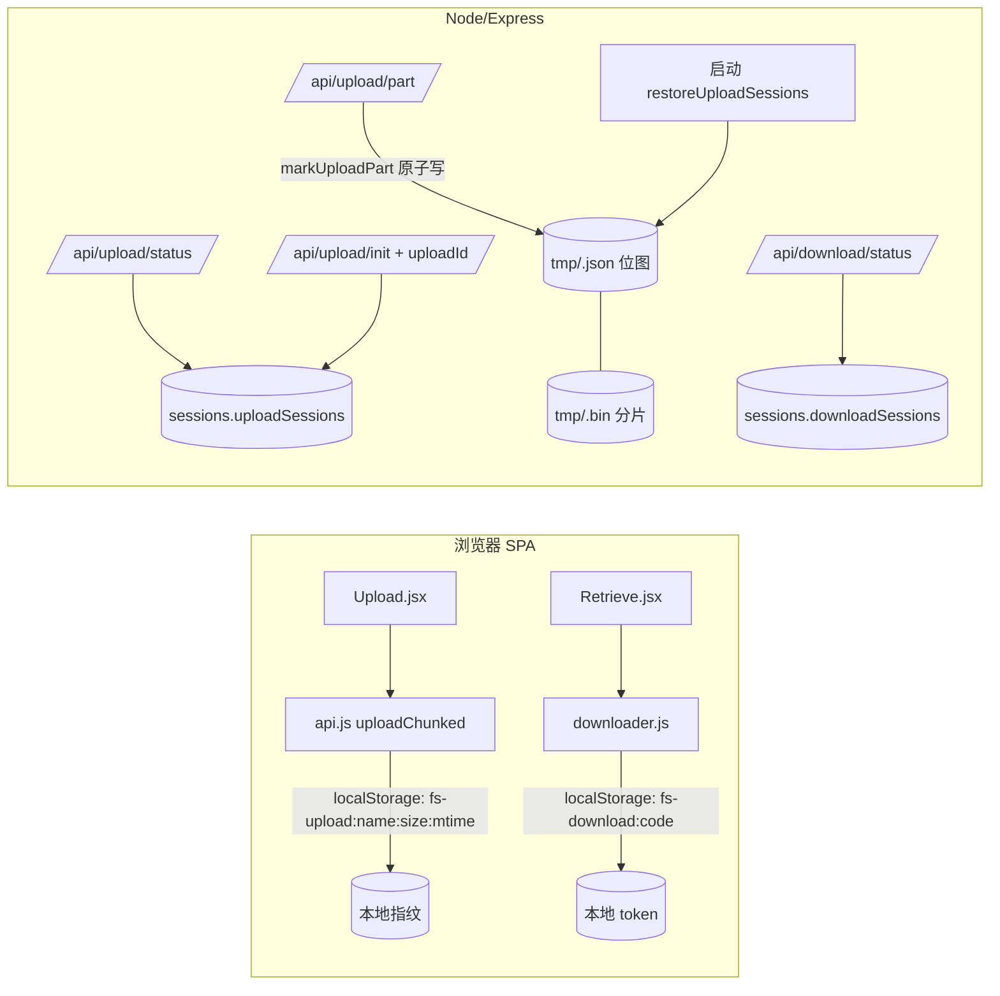

# RFC-003: 分片断点续传（上传会话持久化 + 下载会话续传）

> Status: Implemented (Completed 2026-10-12) | Type: RFC | Created: 2026-10-12 | Updated: 2026-10-12 | Authors: zwh | Reviewers: zwh | Target: v1.3.0 传输可靠性
> 索引：`RFC-003` | 关联 REQ：REQ-024~REQ-029 | 位置：`docs/rfc/RFC-003-resumable-chunked-transfer.md`（权威，无独立 spec 快照）
> 关联 `ADR-012`（上传会话磁盘持久化与安全口径）；与 RFC-001 的分片会话协议、RFC-002 的传输压缩/单元计划**兼容且不改变**（TTL、消费语义、分片寻址均沿用）。
> 一致性声明：`docs/DEVELOPMENT.md` §5/§6/§7 已登记（数据字段、业务规则、接口契约）；**取代 ADR-002 决策 5 中"跨页面断点续传不做"的判断**（其余会话语义沿用）。

## 0. 更新摘要

2026-10-12 首版需求（closure of backlog B1-1）：把"分片传输"从**一次性会话**升级为**可中断/可恢复**：

- **上传**：会话元数据与已收分片位图落盘（`data/tmp/<uploadId>.json` + `<uploadId>.bin`），进程重启后恢复；新增 `GET /api/upload/status` 与 `init` 的 `uploadId` 复用；浏览器刷新/断网后重新选择同一文件即**从缺口继续**。
- **下载**：新增 `GET /api/download/status`（只读续用，**不重复消费下载次数**）；浏览器把 token 存 localStorage，刷新或失败重试优先续用，成功才 `end` 并清理。
- **安全**：上传会话在落盘前把取件密码转为 SHA-256（**明文不再落盘、也不再驻留内存**）。

## 1. 需求

| REQ | 目标 | 基线（RFC-002 后） | 目标 | 验证 |
|---|---|---|---|---|
| REQ-024 | 上传会话跨刷新可恢复 | 客户端刷新丢 `uploadId`，只能整文件重传 | 会话位图落盘；客户端本地存 `uploadId`，重选同一文件自动跳过已收分片 | `scripts/test.js` [26] 乱序取片后 `upload/status` 位图正确；`init` 带 `uploadId` 返回 `resumed:true` 与同一位图 |
| REQ-025 | 上传会话跨进程重启可恢复 | `data/tmp` 启动**整目录清空**，会话必丢 | 启动扫描恢复未过期会话；孤儿/过期文件删除；`complete` 后 JSON 清理 | [26] 子进程探针：构造 JSON+bin → `restoreUploadSessions` 恢复位图、删除孤儿与过期项 |
| REQ-026 | 下载会话可续用且不重复消费 | 每次点击"下载"都 `session` 新建、消费 1 次；刷新即多耗次数 | `GET /api/download/status?token=` 返回原计划（不消费）；客户端优先续用，成功后 `end` | [26] `status` 前后 `totalDownloads` 不变；续用 token 取完分片逐字节一致；`end` 后 `status` 404 |
| REQ-027 | 前端自动续传 | `api.uploadChunked` 失败即从头；`downloader` 失败重试即再消费 | 上传以 `文件名+大小+lastModified` 为指纹存 localStorage；下载按取件码存 token；成功清理、失败保留 | `npm run build` + `scripts/e2e-browser.js` E2E-8（真实浏览器：阻断分片 → 刷新 → 再点下载完成且只消费 1 次） |
| REQ-028 | 安全与对抗 | 上传会话内存里驻留明文密码 30 分钟 | 密码只存 SHA-256；越权/伪造 `uploadId`/`token` 一律 404；位图与实际分片一致 | [26] 落盘 JSON 不含明文、含预期 hash；伪造 id 404；重复上传同片不破坏位图 |
| REQ-029 | 零回归 | `npm test` 231 passed / 0 failed | 既有用例全绿（会话 TTL、消费语义、压缩链路不变） | 全量 `npm test` + `npm run e2e` |

> 基线环境：Windows（Git Bash），Node 24 ESM（要求 ≥18），`npm test` 自启服务器（端口 3999，`DATA_DIR=data-test`，`TRANSFER_PART_SIZE=262144`）。

## 2. 现状根因

- **上传会话只活在内存**（`server/sessions.js` 的 `uploadSessions`）：浏览器刷新后 React 状态丢掉 `uploadId`，服务端会话虽在却"无人认领"；进程重启则位图连同 `tmp` 目录一起清空（`store.clearTmp()` 启动时整目录删除）。
- **下载 token 只活在内存**：刷新/写盘失败后再次点击"下载"，客户端只能新建会话——`tryConsume` 再消费一次，用户为同一份文件损失一次下载配额；中断后重试却要"重新计数"，对限量分享的用户体验不成立。
- **明文密码驻留**：上传会话的 `fields.password` 以明文在内存保存至 `complete`，落盘设计会把它放大成"明文写磁盘"。
- **位图与文件脱节**：`received` 是内存 `Set`，删除/过期只清理 `.bin`；没有任何"哪个分片已收到"的持久事实。

## 3. 总体设计



核心思路：

1. **磁盘位图是唯一事实源**：每次成功收片都原子更新 `tmp/<uploadId>.json` 的 `received`；启动时由 `restoreUploadSessions()` 扫描恢复（有效保留、孤儿/过期删除），取代原来的"整目录清空"。
2. **恢复靠"客户端指纹 + 服务端位图"**：客户端只持久化 `uploadId` 与指纹；恢复时先 `GET /api/upload/status` 拿位图，跳过已收分片。
3. **下载续传是"会话续用"而非"字节续写"**：`GET /api/download/status` 只校验并返回原计划，**不消费**；客户端拿到同一 token 继续取片，成功才 `end`。刷新后浏览器内存里的半成品无法复用，字节层从分片 0 重新拉取——续传保的是下载次数与会话上下文（见 ADR-012 决策 5、§7 非目标）。
4. **密码只以哈希出现**：`init` 即把 `password` 转为 SHA-256 存入会话（内存与磁盘），`complete` 直接提交哈希（单次上传路径不变）。

## 4. 详细设计

### 4.1 上传会话磁盘化（REQ-024/025/028，ADR-012）

`server/sessions.js`：

- `createUploadSession({ tmpDir, partSize, totalParts, size, fields })`：新增 `metaFile = tmp/<id>.json`；创建后立即 `persistUploadSession(session)`。
- `markUploadPart(session, index)`：`received.add(index)` 后原子落盘（写 `<id>.json.tmp` → rename）。
- `persistUploadSession` 字段：`{ version:1, uploadId, partSize, totalParts, size, fields, received:[...], expiresAt }`；`fields` 只含 `filename/mime/note/customCode/expiresIn/maxDownloads/passwordHash`（无明文密码）。
- `dropUploadSession(uploadId)`：删除内存会话并 unlink `.json`/`.bin`（best-effort）。
- `sweepUploadSessions()`：过期项删除文件并返回（60s 定时器沿用）。
- `restoreUploadSessions(tmpDir)`：启动时扫描——`.json` 需通过"版本/过期时间/数值字段/位图范围/bin 存在"校验才恢复；不合法或过期 ⇒ 删除 `.json`+`.bin`；无主 `.bin`/临时文件 ⇒ 删除。返回恢复数量。

`server/index.js` 启动流程：`clearTmp()` → `restoreUploadSessions(config.tmpDir)`（`store.clearTmp` 删除，语义并入恢复函数）。

`server/transfer.js`：

- `prepareFields` 之后计算 `passwordHash = password ? hashPassword(password) : ''`，会话 `fields` 不再保留 `password`。
- `PUT /api/upload/part`：`session.received.add(index)` 改为 `markUploadPart(session, index)`。
- `POST /api/upload/complete`：commit 传 `passwordHash`；成功/`CODE_TAKEN` 路径都调 `dropUploadSession`（自动清理 JSON+bin）。

`server/store.js`：导出 `hashPassword`；`commitUpload` 支持 `info.passwordHash`（有则直接用，否则照旧对明文哈希，单次上传路径零改动）。

### 4.2 上传恢复协议（REQ-024/027）

新增 `GET /api/upload/status?uploadId=`（无鉴权，uploadId 本身是 192-bit 随机 bearer）：

```json
{ "uploadId": "…", "filename": "报告.pdf", "size": 10485760, "mime": "application/pdf",
  "partSize": 4194304, "totalParts": 3, "received": [0, 2], "expiresAt": 1791810000000 }
```

`POST /api/upload/init` 扩展：请求体可带 `uploadId`（与 `filename`/`size` 一起）。

- 命中且 `filename`/`size` 一致 ⇒ 复用会话，响应 `{ uploadId, partSize, totalParts, resumed: true, received: [...] }`，**不占用上传限流额度**（幂等恢复，防刷新刷爆限流）。
- 未命中/过期 ⇒ 按新会话处理（`resumed: false, received: []`）。
- 命中但元数据不一致 ⇒ `409 上传会话与文件不匹配`（避免把 A 的位图套到 B 的文件上）。
- 新会话计一次限流（沿用旧行为）。

客户端（`web/src/api.js` `uploadChunked`）：

- 指纹键 `fs-upload:<name>:<size>:<lastModified>`；init 成功存 `{ uploadId, filename, size, updatedAt }`。
- 启动时若有本地记录 ⇒ `upload/status` 校验（文件名/大小一致）⇒ 从位图继续；失败则清除记录、新开会话。
- 每片成功后不回写位图（服务端是事实源），只在 `complete` 成功后清除记录；失败保留以便再次点击继续。
- 首次进度回调携带 `resume: { receivedParts, totalParts }`，`Upload.jsx` 弹一次 `message.info('已恢复上次未完成的上传（x/y 片）')`。

### 4.3 下载会话续传（REQ-026/027）

新增 `GET /api/download/status?token=`（不消费、不改 TTL）：

```json
{ "token": "…", "partSize": 4194304, "filename": "…", "size": 10485760, "mime": "…",
  "expiresAt": 1791810000000, "compressed": true, "units": [[0,1234],…], "unitCount": 9, "parallel": 2 }
```

与 `POST /api/download/session` 的响应同构；文件/容器损坏校验与取片路径一致（损坏 ⇒ `500`）。`token` 无效/过期 ⇒ `404`。

客户端（`web/src/downloader.js`）：

- 键 `fs-download:<code>`，存 `{ token, filename, size, updatedAt }`。
- 开始下载：先 `download/status` 续用（文件名/大小一致）；失败/无效则走原流程（`showSaveFilePicker` → `session` → 存 token）。
- **成功**才 `endDownloadSession` 并清除本地记录；失败/取消保留 token（TTL 10 分钟内再次点击不重复消费，超时回退新建并按旧语义消费）。
- 返回对象增加 `resumed` 字段（供页面提示/断言）。

## 5. 错误处理与可观测性

| 失败模式 | 行为 |
|---|---|
| `uploadId` 不存在/过期 | `GET status` 与 `part`/`complete` 均 `404`；`init` 带无效 id 时静默降级为新会话 |
| `init` 带 `uploadId` 但文件名/大小不一致 | `409 上传会话与文件不匹配`（客户端清除本地记录后重试） |
| 位图 JSON 损坏/越界/类型错误 | 启动恢复时整对删除（宁可再生，不冒用脏位图）；`part` 写入时原子替换，读到半文件不可能 |
| `tmp` 有 `.bin` 无 `.json`（或反之） | 启动恢复删除孤儿；运行中 `part` 找不到会话即 404，不写文件 |
| 收片后崩溃 | 位图已随每片原子落盘，重启后最多回退到"最后一次成功收片"（不会重复计数，重传该片幂等覆盖） |
| 下载 token 被伪造/过期 | `status`/`part` 一律 `404`；客户端回退新建会话（消费 1 次，与旧行为一致） |
| 下载失败后未重试 | 会话保留至 TTL（10 分钟）后由清扫器回收；不影响分享回收判定 |

## 6. 验收

| REQ | 结果 | 证据 |
|---|---|---|
| REQ-024 | ✅ 通过 | `scripts/test.js` [26]：乱序收片（0、2）后 `upload/status` 位图 = `[0,2]`；`init` 带 `uploadId` 返回 `resumed:true` 与同一位图，且上传限流计数不增；补 1 号片后 `complete` 成功、内容逐字节一致；文件名/大小不一致返回 `409` |
| REQ-025 | ✅ 通过 | [26] 子进程探针：写入未过期会话（JSON+bin）+ 过期会话 + 孤儿 bin → `restoreUploadSessions` 仅恢复有效会话（位图为 `[0]`），过期与孤儿被删除；`complete` 成功后 `tmp/<id>.json` 与 `.bin` 均被清理 |
| REQ-026 | ✅ 通过 | [26]：`download/status` 前后 `totalDownloads` 不变；用 status 返回的同一 token 取完全部分片逐字节一致；`end` 后 status `404`；伪造 token `404` |
| REQ-027 | ✅ 通过 | `npm run build` 成功；E2E-8：真实浏览器下载中断（阻断分片请求）→ `Page.reload` → 再点下载完成、落地文件 SHA-256 一致，且全程 `totalDownloads` 只 +1，localStorage 记录随成功清除 |
| REQ-028 | ✅ 通过 | [26]：落盘 JSON 文本不含明文密码（含预期 SHA-256）；伪造 `uploadId` ⇒ `404`；重传已收分片后位图不重复、`complete` 仍成功 |
| REQ-029 | ✅ 通过 | `npm test` **249 passed / 0 failed**（B4-9 基线 231 + 新增 18）；`npm run e2e` **37 passed / 0 failed**（新增 8 条 E2E-8）；`npm run build` 成功 |

## 7. 非目标

- **刷新后的下载字节级续写**：浏览器刷新后管道/内存缓冲已失，非 OPFS 句柄持久化不能安全追加；续传价值定义为"会话与配额续用 + 同会话内重试不重复计数"（ADR-012 决策 5）。OPFS 句柄持久化（IndexedDB 存 `FileSystemFileHandle`）列为后续评估（backlog B4-10）。
- **跨设备/跨浏览器续传**：匿名服务无身份体系，恢复凭据只存本机 localStorage（含"换设备=从头"的取舍）。
- **服务端持久化下载会话**：内存 + TTL 足够（10 分钟窗口）；持久化换来的是重启用例，但会引入"下载会话随进程死亡"之外的第二套生命周期。
- **滑动 TTL / 无限续传**：上传 30 分钟、下载 10 分钟均保持**绝对过期**（防匿名服务被长期占用）；续传窗口 = TTL 内。
- **多文件并行续传的本地记录管理**：一个文件一条记录，不做过期归档与 LRU。

## 8. 追溯

> 实现追溯：代码/测试 `0491e16`（`feat: 分片断点续传（上传会话持久化 + 下载会话续传）`），文档随后提交（同一 `master`）；验收为 `npm test` 249 passed / 0 failed 与 `npm run e2e` 37 passed / 0 failed（新增 E2E-8 真实浏览器续传，8 条断言）。
> 组件 ↔ 测试 ↔ ADR 追溯矩阵见 `docs/architecture/C3-component.md` §5；遗留项见 `docs/backlog.md` B4-10。
