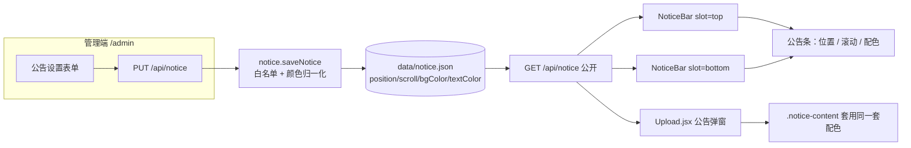

# RFC-004: 公告样式（位置 / 滚动 / 配色）

> Status: Implemented (Completed 2026-10-12) | Type: RFC | Created: 2026-10-12 | Updated: 2026-10-12 | Authors: zwh | Reviewers: zwh | Target: v1.4.0 站点运营
> 索引：`RFC-004` | 关联 REQ：REQ-030~REQ-035 | 位置：`docs/rfc/RFC-004-notice-style-position-scroll.md`（权威，无独立 spec 快照）
> 关联 `ADR-013`（公告样式模型：白名单枚举 + 空值即默认主题）；与 RFC-001~003 的传输链路**无交集**（仅公告单例 JSON 与三个前端组件）。
> 一致性声明：`docs/DEVELOPMENT.md` §5（数据模型）/§7（接口契约）/§8（页面契约）已登记。

## 0. 更新摘要

2026-10-12 首版需求：把公告从「弹窗/顶部条二选一 + 固定蓝底 + 单行跑马灯」升级为**可配置的运营位**：

- **位置**：`top`（流内顶部，默认）/ `bottom`（流内底部）/ `fixed-top`（悬浮顶部）/ `fixed-bottom`（悬浮底部）。
- **滚动**：`none`（静态单行省略）/ `left`（右→左）/ `right`（左→右）/ `up`（纵向向上）/ `bounce`（纵向往返）。横向模式**一律滚动**（内容装得下时自动重复填满整条），纵向模式需内容 ≥2 行（见 §0 增量二）。
- **配色**：`bgColor` + `textColor` 自定义十六进制色；**同时作用于公告条与公告弹窗**；留空即跟随默认主题。
- **校验**：位置/滚动为白名单枚举，颜色为 `#RGB`/`#RRGGBB`；非法值一律回落默认，旧 `notice.json` 自动补齐新字段（零迁移）。

2026-10-12 增量二（真实使用反馈：选中的滚动方式“看不到动”）：把横向滚动的触发条件从「内容必须超出可视宽度」改为**一律滚动**——内容装得下时按 `ceil(视口宽 / (内容宽 + 间距))` 计算并重复内容填满整条，循环位移仍为轨道的一半（`translateX(0→-50%)`），因此短公告也能像真正跑马灯一样持续滚动；纵向模式保持「内容高度超出视口才滚」，并在管理端明确提示「需 ≥2 行内容」（单行纵向滚动没有可见位移）。同时把公告条抽成可传入数据的 `NoticeBarView`，管理端用它做**实时预览**并显示当前是否会滚动。原因与依据见 ADR-013 决策 7（已修订）。

2026-10-12 增量三（两种模式都要保留）：把「横向是否自动填满」改成公告自身的开关 `scrollFill`——**默认关闭**（内容未超出可视宽度就不触发滚动，即首版行为），开启则一律滚动（自动重复填满）。管理端以「内容不足时：不滚动 / 自动填满滚动」开关呈现，实时预览同步回报当前是否会滚。开关随公告落盘，因此**预设也自动携带**该模式。原因与依据见 ADR-013 决策 7（修订二）。

## 1. 需求

| REQ | 目标 | 基线（RFC-003 后） | 目标 | 验证 |
|---|---|---|---|---|
| REQ-030 | 公告条位置可选 | 固定渲染在页头下方 | 四种位置：流内顶部/底部、悬浮顶部/底部（悬浮 `position: fixed`，`z-index` 低于 antd 弹窗） | `scripts/test.js` [6] 位置白名单与持久化；`scripts/e2e-browser.js` E2E-9 断言 `position/bottom/top` 计算值 |
| REQ-031 | 滚动方式可选 | 仅「超宽时右→左跑马灯」 | 五种：静态、右→左、左→右、纵向向上、纵向往返；横向由 `scrollFill` 开关决定「仅超出才滚（默认）」或「一律滚动（自动填满）」；纵向溢出才滚（需 ≥2 行）；悬停暂停 | [6] 滚动白名单；E2E-9 断言 `animationName`、副本数与轨道宽、溢出方向（含「内容装得下也滚」） |
| REQ-032 | 自定义配色 | 固定 antd info 底色 | `bgColor`/`textColor`（十六进制）应用到公告条与弹窗内容块；留空回退默认主题 | E2E-9 断言计算样式 `rgb()` 与回退值 |
| REQ-033 | 服务端校验与向后兼容 | 仅 `display` 有白名单 | 位置/滚动白名单 + 颜色归一化（三位补全、小写）；非法回落默认；旧文件补齐字段 | [6] 非法值回落、`#ABC → #aabbcc`、非十六进制归零、旧 `notice.json` 兼容 |
| REQ-034 | 管理端可配置 | 开关 / 显示方式 / 标题 / 内容 | 增位置、滚动方式、背景色、文字色（含清除）与实时预览块 | `npm run build` + 管理端渲染；E2E-6 既有管理端用例不回归 |
| REQ-035 | 零回归 | `npm test` 249 passed / 0 failed | 公告既有语义（空内容强制关闭、401、`display` 回退）全部保持 | 全量 `npm test` + `npm run e2e` |

> 基线环境：Windows（Git Bash），Node 24 ESM（要求 ≥18），`npm test` 自启服务器（端口 3999，`DATA_DIR=data-test`）；浏览器用例为 headless Chrome 154（CDP）。

## 2. 现状根因

- **位置写死在 JSX**：`NoticeBar` 只在 `App.jsx` 的 header 之后渲染一次，运营想要「底部条」或「悬浮常驻条」只能改代码。
- **滚动只有一种**：`scrollWidth > clientWidth` 触发单行跑马灯，方向固定右→左；长文本在视觉上只能横向扫过，纵向信息（多行公告）没有承载方式。
- **配色写死在 CSS**：`.notice-bar-alert` 用 antd `info` 主题色，`.notice-content` 固定 `#333`；运营无法让公告贴合站点品牌色。
- **数据模型无扩展位**：`notice.json` 只有 `enabled/title/content/display`，`server/notice.js` 的校验也只覆盖 `display`，任何新字段都会被静默丢弃。

## 3. 总体设计



- **单组件双槽位**：`App.jsx` 渲染 `<NoticeBar slot="top">` 与 `<NoticeBar slot="bottom">`；组件按 `position` 归属槽位（`top`/`fixed-top` → 上槽，`bottom`/`fixed-bottom` → 下槽），因此同一时刻至多一个实例可见，关闭记录仍按 `updatedAt` 版本生效。
- **一次抓取**：两个实例共享模块级 `noticePromise`，公开接口只请求一次。
- **滚动一律先量后动**：无论哪种模式，先比较「内容尺寸 vs 视口尺寸」，只有溢出才挂 `.scrolling`；纵向模式把内容换行后比较高度。

## 4. 详细设计

### 4.1 服务端（`server/notice.js`）

```json
{
  "enabled": true,
  "title": "维护通知",
  "content": "本周日凌晨 2 点服务维护……",
  "display": "both",
  "position": "fixed-bottom",
  "scroll": "up",
  "bgColor": "#112233",
  "textColor": "#ffee00",
  "updatedAt": 1760000000000
}
```

- 白名单：`POSITIONS = ['top','bottom','fixed-top','fixed-bottom']`（默认 `top`）、`SCROLLS = ['none','left','right','up','bounce']`（默认 `left`）。
- 颜色：`/^#?([0-9a-fA-F]{3}|[0-9a-fA-F]{6})$/`；三位补成六位、统一小写、带不带 `#` 都接受；不匹配 ⇒ `''`（跟随默认主题）。
- 同一份 `normalize()` 同时用于**读**与**写**：`getNotice()` 对磁盘数据归一化（旧文件自动补齐默认值、手工改坏的字段自动纠正），`saveNotice()` 再盖 `updatedAt`。
- 既有语义不变：`content` 为空强制 `enabled=false`；`display` 非法回退 `modal`；写盘仍是「临时文件 + rename」原子替换。

### 4.2 前端公告条（`web/src/components/NoticeBar.jsx`）

| 关注点 | 实现 |
|---|---|
| 位置 | `fixed-*` ⇒ 内联 `position: fixed` + `top/bottom: 0` + `z-index: 900`（低于 antd Modal 的 1000，弹窗永远在上层）；流内位置保持 `relative` |
| 静态 | `scroll = none` ⇒ 单行 `nowrap` + 省略号，永不挂 `.scrolling` |
| 横向 | `left`/`right` 分两档（`scrollFill` 决定）：**关闭**（默认）⇒ 仅 `scrollWidth > clientWidth` 时滚，两份副本；**开启** ⇒ 一律滚动，`每半份 = ceil(视口宽 / (内容宽 + 64))`、总副本 `2 × 每半份`、时长按 `半轨道宽 / 60px/s` 且 ≥6s（半轨道 ≥ 视口宽，故循环无缝不露白） |
| 纵向 | `up` ⇒ 内容 `pre-wrap` 换行、复制一份、`translateY(0 → -50%)`，时长按 `溢出高度 / 24px/s` 且 ≥4s；`bounce` ⇒ 单份内容 `translateY(0 → -溢出高度)`、`alternate` 往返 |
| 配色 | `bgColor` 同时改 `background` 与 `borderColor`；`textColor` 内联到跑马灯容器（子元素继承，胜过类选择器） |
| 关闭 | 仍按 `notice-bar-closed-<updatedAt>` 记录，改配置即视为新公告 |

### 4.3 弹窗（`web/src/pages/Upload.jsx` + `web/src/utils.js`）

- 新增 `utils.noticeColors(notice)` → `{ background, color }`（只含有值的键），公告弹窗内容块与公告条共用同一口径。
- `.notice-content` 增加 `padding: 12px; border-radius: 8px`，作为「彩色公告块」嵌在弹窗内，不改变弹窗自身配色。

### 4.4 管理端（`web/src/pages/Admin.jsx`）

- 新增 4 个控件：位置（4 按钮）、滚动方式（5 按钮）、背景色 / 文字色（`ColorPicker` + `allowClear` + `showText`）。
- 实时预览块 `.notice-preview-wrap`：直接用当前表单值渲染真实公告条（`NoticeBarView preview`，强制 `position: static` 不悬浮），下方一行「实时预览：横向滚动中 / 纵向需 ≥2 行内容…」说明当前是否会滚动。
- 保存/载入沿用 `/api/notice`，回填新字段；文案注明「位置与滚动仅对公告条生效，配色同时作用于公告条与弹窗」。

## 5. 错误处理与可观测性

| 失败模式 | 行为 |
|---|---|
| 位置/滚动值非法（旧前端或手工请求） | 回落默认 `top` / `left`，请求仍 `200`（不因样式错让公告保存失败） |
| 颜色格式非法（`rgb()`、`#12345`、单词色） | 存 `''`，前端用默认主题色渲染 |
| 旧 `notice.json` 缺新字段 | 读取时自动补齐默认值；不写回磁盘，首次保存才落新结构 |
| 内容为「一条超长不换行的字符串」 | 纵向模式用 `pre-wrap + word-break` 强制换行；横向模式保持单行跑马灯 |
| 悬浮条与弹窗同时出现 | 悬浮条 `z-index: 900` < 弹窗 1000，弹窗可正常操作与关闭 |
| 视口过窄导致内容溢出 | 悬浮条左右贴边铺满；`resize` 时重新测量（长度阈值 ±1px 容差） |

## 6. 验收

| REQ | 结果 | 证据 |
|---|---|---|
| REQ-030 | ✅ 通过 | `scripts/test.js` [6]：`position: 'fixed-bottom'` 保存并公开读取一致、非法值回落 `top`；E2E-9：`fixed-bottom` 计算 `position: fixed`/`bottom: 0px`，`fixed-top` 计算 `top: 0px`，`top` 计算 `position: relative` |
| REQ-031 | ✅ 通过 | [6]：`scroll: 'up'` 保存一致、非法值回落 `left`、`scrollFill` 默认 `false` 且可保存 `true`；E2E-9：纵向 `animationName = notice-bar-marquee-up`（副本 2、纵向溢出且无横向溢出）；静态模式无动画且保留横向省略；横向超长内容滚动且轨道 ≥ 视口；**短内容在 `scrollFill=false` 时不滚（保留首版行为）、在 `true` 时自动填满滚动且副本 ≥3 份**；E2E-10：管理端开关可开可关、实时预览回报滚动状态、预设摘要标注「自动填满滚动」 |
| REQ-032 | ✅ 通过 | E2E-9：公告条计算背景 `rgb(17, 34, 51)`、文字 `rgb(255, 238, 0)`，同一份数据渲染的弹窗内容块计算样式与之一致；未配色时背景回退主题色（`rgb(230, 244, 255)`） |
| REQ-033 | ✅ 通过 | [6]：`#ABC → #aabbcc`、`rgb(1,2,3)` 与单词色归零、非法位置/滚动回落默认、手工写入的旧 `notice.json`（仅 `enabled/title/content/display`）读取后补齐 `position: top`、`scroll: left`、空颜色 |
| REQ-034 | ✅ 通过 | `npm run build` 成功；管理端新增位置/滚动/配色控件与实时预览（`.notice-preview-wrap` + `NoticeBarView`，并显示是否会滚动）；E2E-6/E2E-10 管理端用例保持通过 |
| REQ-035 | ✅ 通过 | 首版：`npm test` 255 passed / 0 failed、`npm run e2e` 46 passed / 0 failed；增量二：`npm test` **270 passed / 0 failed**（含 RFC-005 的 15 条）、`npm run e2e` **59 passed / 0 failed**（E2E-9 增至 11 条、E2E-10 增至 11 条）；`npm run build` 成功 |

## 7. 非目标

- **富文本/HTML/Markdown 公告**：`content` 仍是纯文本（`pre-wrap` 渲染），不引入渲染器，避免 XSS 面。
- **字号/圆角/间距/透明度定制**：本期只做背景色与文字色（ADR-013 取舍）。
- **多公告并存 / 定时投放 / 优先级队列**：仍是单例 `notice.json`（一条公告），需要多公告时应先设计数据模型与调度（列 backlog）。
- **公告条与菜单共存时的布局重排**：悬浮条覆盖在内容之上，不挤压页面布局；流内条随文档流。
- **无障碍增强（ARIA live / 尊重 `prefers-reduced-motion`）**：**已实现（backlog B5-1 关闭，ADR-013 修订三）**——系统开启「减少动态效果」时四种滚动一律降级为静态（保留单行省略与 `title` 完整提示），视图带 `role="status"` + `aria-live="polite"`，CSS 额加 `@media` 兜底。

## 8. 追溯

> 实现追溯：首版代码/测试 `0030699`、增量二 `d9ba044`、增量三（`scrollFill` 开关两种模式并用）`47b3e57`、增量四（backlog B5-1 动效无障碍：`NoticeBar.jsx` 的 `useReducedMotion()` 降级 + `role=status`/`aria-live`、`index.css` 的 `@media (prefers-reduced-motion)` 兜底、E2E-9 的 `Emulation.setEmulatedMedia` 真实验证）与 backlog B1-3/B6-1~B6-4 同批提交；本批验收为 `npm test` **301 passed / 0 failed** 与 `npm run e2e` **78 passed / 0 failed**（含 E2E-9 无障碍断言、E2E-11 预设运维断言）。
> 组件 ↔ 测试 ↔ ADR 追溯矩阵见 `docs/architecture/C3-component.md` §5；遗留项见 `docs/backlog.md` B5。
